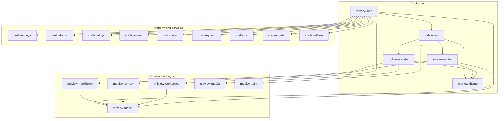
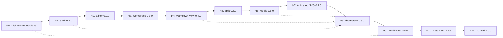

# Product Roadmap — MD View (working title)

**Native Markdown, text, and code editor for Windows, macOS, and Linux. From zero to `1.0.0`.**

> Roadmap layout document. Organized by phases, milestones, and dependencies. It contains no dates, durations, sprints, or effort estimates.

## Contents

- [0. Reviewed craft-libs baseline and starting decisions](#0-reviewed-craft-libs-baseline-and-starting-decisions)
- [1. Executive summary](#1-executive-summary)
- [2. Proposed architecture](#2-proposed-architecture)
- [3. Dependency map](#3-dependency-map)
- [4. Gap analysis](#4-gap-analysis)
- [5. Technical risk matrix](#5-technical-risk-matrix)
- [6. Phases and milestones](#6-phases-and-milestones)
- [7. Semantic versioning and releases](#7-semantic-versioning-and-releases)
- [8. Definition of done for 1.0.0](#8-definition-of-done-for-100)
- [9. Post-1.0 roadmap](#9-post-10-roadmap)
- [10. Open questions](#10-open-questions)
- [Appendix A — 1.0 support matrices](#appendix-a--10-support-matrices)

## Implementation status

| Milestone | Status | Evidence |
|---|---|---|
| H0 | NOT STARTED as a separate spike phase | The H1 shell uses conventional egui widgets. The H0 risk gates remain for the editor, Mermaid, LaTeX, and animated SVG milestones. |
| H1 | DONE (Linux) | Native shell, settings, i18n, base themes, atomic save, CLI, and single-instance path forwarding are implemented and tested on Linux. Native dialog interaction is exercised by the H3 sidebar operations; macOS/Windows checks are deferred to 1.0.0. |
| H2 | DONE (Linux) | Rope editor, virtualization, syntax highlighting, tab/space detection, find/replace, go-to-line, encoding/EOL, mixed-EOL preservation, wrap, background large-file loading, progress/cancellation, IME commit coverage, AccessKit role/value/selection announcements, and four light/dark × wrap snapshots are implemented and tested on Linux. |
| H3 | DONE (Linux; OS-rename identity matching deferred) | Tabs, lazy sidebar, watcher with polling fallback, clean reload, conflict diff, missing-file state, file operations, recent files/workspaces, multi-path opening, session restore, active-tab explorer reveal, and a fixed external-files group are implemented and tested on Linux. Snapshots cover sidebar, external files, tabs, conflict banner, and diff. |
| H4 | DONE (Linux) | CommonMark/GFM AST with spans, reading view, safe HTML, links, alerts, tasks, tables, footnotes, code highlighting, source map, per-mode scroll, light/dark snapshots, and app tests. |
| H5 | DONE (Linux) | Resizable split, per-file ratio, bidirectional block-anchor sync, echo suppression, hover-aware conflict resolution, and horizontal/vertical snapshots. |
| H6 | DONE (Linux) | Bounded images/SVG/math/Mermaid media pipeline, remote cache, lightbox, worker isolation, and light/dark rich-content snapshots. |
| H7 | DONE (Linux) | SMIL/CSS animation subset with 30 fps playback, reduced motion, offscreen pause, fuzz/hostile tests, and 50 MB scale coverage. |
| H8 | DONE (Linux; screen-reader/platform checks deferred) | Nine theme variants, contrast tests, settings, command palette, quick open, scaling, pseudo-locale, centered reading layout, and UI snapshots. |
| H9 | DONE (Linux local artifacts; Windows/macOS signing deferred) | AppImage, deb, RPM, tarball, icons, associations, SBOM, SHA-256SUMS, update manifest/check/download, WiX/macOS/Flatpak sources, and `release-check`. |
| Post-0.9 UI | DONE (Linux) | Icon header, Material Icon Theme tree, block-virtualized preview, header/sidebar/virtualization snapshots, 120-event scroll stress, and 120 Hz frame-budget gate. |
| 0.14.0 pre-1.0 review | DONE (Linux) | All findings in the pre-1.0 review resolved: licenses/deny/CI, scroll ends, segmented modes, title-bar history/search, find overlay, editor parity, image zoom/pan, icon/reading polish, and the required E2E/golden-image coverage. Evidence: `docs/pre-1.0-review.md`. |
| 1.0.0-rc.0 | DONE (Linux; unsigned macOS/Windows RC) | Published the first public release candidate: [release assets](https://github.com/jigonzalez930209/md-view-rs/releases/tag/v1.0.0-rc.0), [VitePress docs](https://jigonzalez930209.github.io/md-view-rs/), Oniguruma syntax compilation, active-tab explorer reveal, external-files group, taller search results, and tag-driven Linux/macOS/Windows builds with `SHA256SUMS` and `latest.json`. Evidence: Release run `43787553166`, Docs run `43787543486`, `cargo xtask ci`, and downloaded-asset checksum verification. |
| 1.0.0-rc.1 | IN PROGRESS (Linux; unsigned macOS/Windows RC) | Flicker-free split view: continuous invertible editor/preview offset map, clamped follower targets, discarded out-of-range and re-layout passes, sticky leader across zoom/resize/wrap, and exact end synchronization. Evidence: `split_sync` frame tests including a rendered-pixel zoom test, E2E split-zoom stage with zero overshoot paints, `cargo xtask ci`. |
| 0.13.0 reading and viewers | DONE (Linux) | Six-tab settings with three reading-width presets and independent body/heading/code/table sizes, aligned list markers, persistent tab close affordance, thin scrollbars, non-animated split sync, and a read-only viewer plugin registry with the image plugin; the API is internal for `1.0`. |
| 0.12.0 workbench | DONE (Linux) | Explorer under the menu with editor-only tabs, Cursor-style tab surfaces, standalone PNG/JPEG/GIF/WebP/BMP/TIFF/SVG image documents, compact reading margins, and larger Material icons. |
| 0.11 workbench | DONE (Linux) | VS Code-like title/menu/tab/activity layout, settings modal tabs, compact context menus, centered fields, numeric steppers, workspace Quick Open, 1 MiB rotating logs, and `cargo xtask e2e`. |
| Pre-1.0 review | DONE (Linux) | All release, scrolling, icon, and UX findings are resolved and verified in [`docs/pre-1.0-review.md`](docs/pre-1.0-review.md). |
| H10–H11 | NOT STARTED | Blocked by signed Windows/macOS artifacts and the final platform manual matrix, not by the pre-1.0 code review. |

---

## 0. Reviewed craft-libs baseline and starting decisions

The brief starts from an earlier inventory of `craft-libs`. The current monorepo contains more crates than that inventory lists. In particular, `craft-markdown`, `craft-math`, `craft-latex`, and `craft-svg` already exist, along with platform services such as `craft-window`, `craft-menu`, `craft-keymap`, `craft-dialogs`, `craft-platform`, and `craft-update`.

That **does not remove the gaps**, but it changes the dependency map and requires precision about what is reused and what is not:

| Baseline piece | What it actually provides | Decision for this project |
|---|---|---|
| `craft-ui` | SVG catalog, `IconButton`, `tabs::Tab`/`tabs::fit`, split geometry and `ResizeHandle`, `theme::WidgetPalette`, font stack, `screen-testing`. It does not include a code editor, a file tree, or Markdown rendering. | Use it as the UI base. **Do not** use `docking` in 1.0: document tabs and the sidebar are not dockable panels; adding docking introduces state and chrome that do not help the product. |
| `craft-settings` | `config.toml`, platform folders, atomic saves, backup, recovery, schema migrations. | Use for preferences, session, and recent files. |
| `craft-atomic` | Same-directory staging, fsync, retries, `write_new`. | Use for every document save. |
| `craft-docpath` | Validates local paths and `file:` paths in documents; rejects network, device, and URL paths. | Use for local images referenced by Markdown. `http(s)` URLs are handled separately and never go through `docpath`. |
| `craft-i18n` | Catalogs, plurals, fallback, system locale, regional formats. | Use with English and Spanish catalogs pinned for reproducible builds. |
| `craft-quit` | Native macOS quit and egui close hook. | Use it; the save/cancel decision remains app-owned. |
| `craft-svg` | Full SVG parser on `usvg` 0.48.1, safety limits, and draw budget. | Use for static SVG. Add `resvg` 0.48.1, the version paired with `usvg`. |
| `craft-window` | Native/integrated title bar policy and draggable strip. | Use for the main window. |
| `craft-menu` + `craft-keymap` | Native/in-window menus, shortcuts, conflicts, key capture. | Use as the single command catalog and dispatch layer. |
| `craft-dialogs` + `craft-platform` | Non-blocking native dialogs and lifecycle; Linux/BSD desktop appearance observation. | Use for open/save/folder dialogs and system theme following. |
| `craft-update` | Release checking, download, and installation; supports MSI, DMG, AppImage, deb, rpm, and Flatpak. | Use for the 1.0 updater, with signature/checksum verification and no silent updates. |
| `craft-markdown` | Markdown ↔ `craft-flow` converter with GFM tables and strikethrough. It is not a renderer, does not expose source spans, and does not fully cover task lists/footnotes. | **Do not** use it on the render path. Re-evaluate for export/Post-1.0. |
| `craft-math` | Parses LaTeX math into an Office Math-style tree; it does not compose or draw. | **Do not** use it as the layout engine. Re-evaluate for MathML/OMML export. |
| `craft-latex` | Reads and writes LaTeX documents; it does not render math. | Outside the 1.0 render path. |
| `craft-pdf` | PDF parsing and rasterization. | Reserved for Post-1.0, as the brief requires. |
| `craft-print` | System printing. | Post-1.0. |
| `craft-ai-core` | AI contract. | Post-1.0, opt-in. |

**Pinning policy.** Every `craft-*` crate is pinned to **one reviewed revision** of the monorepo (`rev = "<SHA>"`), never to a moving `main` and never by mixing tags. The selected revision must contain every crate used. `Cargo.lock` is committed and builds use `--locked`. The `egui` version is pinned exactly to the one declared by the selected `craft-ui` revision; the current `main` uses egui 0.37, while the `v0.1.0` release documents egui 0.36. That difference is resolved in H0, not carried forward.

---

## 1. Executive summary

### 1.1 Product

A native desktop application for opening a folder as a workspace, editing Markdown, text, and code, and viewing rendered Markdown without leaving the app. The promise is a lightweight editor — fast, quiet, carefully typeset, and distraction-free — that also understands the workspace: tabs, a reactive file tree, on-disk reloads, internal links, and a preview that stays synchronized with editing.

It is not an IDE, not a collaboration tool, not a web app, and it does not depend on an embedded browser.

### 1.2 Target user

- Developers who read and write documentation inside a repository.
- Technical people who maintain notes, READMEs, ADRs, and project documentation.
- Linux, macOS, and Windows users who value a native, fast app with real keyboard support.

### 1.3 Design principles

1. **Truly native.** egui/eframe, with no Electron, Tauri, Wails, NW.js, or embedded webview. No JavaScript engine renders content.
2. **Local-first and private by default.** No telemetry. Remote images are fetched only because a document references them, and the feature can be disabled. The app works fully offline.
3. **Instant.** Short startup, imperceptible typing latency, smooth scrolling, and heavy work off the UI thread.
4. **Content first.** Minimal chrome, consistent typography and spacing, subtle animation, and never at the expense of reading or writing.
5. **Safe under failure.** Atomic saves, an explicit conflict policy, and no silent overwrite of external changes.
6. **One source of truth.** The document buffer is authoritative; preview, tree, and tab state are derived.
7. **Tokens, not loose colors.** The UI, highlighting, and Markdown view are built from a token system; no component invents colors.
8. **Accessible by default.** Full keyboard navigation, visible focus, AA contrast, scaling, and screen-reader support in primary flows.
9. **Cross-platform without forking the product.** One UX, with native conventions where they matter: macOS menu, title bar, dialogs, file associations, and packaging.
10. **Disciplined scope.** 1.0 is complete and defensible; PDF, printing, AI, and plugins stay out.

### 1.4 1.0 success statement

A user can install the app from a signed package on their system, open a folder, browse the tree, open several files in tabs, edit Markdown in View/Edit/Split modes, see tables, tasks, footnotes, highlighted code, math, Mermaid, local and remote images, and SVG — including animated SVG within the supported matrix — save without risk, receive external changes under a clear policy, and update the app, all with the interface in English or Spanish and without depending on a browser.

---

## 2. Proposed architecture

### 2.1 Layers and boundaries

The central rule is that **the core does not know egui** and **the UI does not perform I/O directly**:

```text
Platform / adapters
  eframe, craft-window, craft-menu, craft-keymap, craft-dialogs,
  craft-settings, craft-atomic, craft-update, notify, ureq
        │
        ▼
Application (orchestration)
  mdview-app: window, commands, session, jobs, watcher, updater
        │
        ▼
UI (egui)
  mdview-ui, mdview-editor, mdview-render, mdview-theme
        │
        ▼
Core (pure Rust, no egui)
  mdview-model, mdview-markdown, mdview-syntax,
  mdview-workspace, mdview-media
```

Concrete rules:

- `mdview-model` depends on neither egui nor the filesystem.
- `mdview-markdown` produces an AST with spans; it does not draw.
- `mdview-media` downloads, decodes, and rasterizes; it does not upload textures or touch the egui context. It exposes `MermaidEngine`, `MathEngine`, and `SvgFrameSource` traits so `mmdr`/RaTeX or the animation runtime can be replaced without touching the renderer.
- `mdview-render` composes blocks and paints with egui; it does not write files.
- `mdview-editor` is an editing widget; it does not open or save files.
- `mdview-app` is the only layer that connects the filesystem, settings, watcher, updater, and UI.
- No worker touches `egui::Context`; the UI collects results and uploads textures on the main thread.

### 2.2 Workspace crates

| Crate | Responsibility | Depends on | egui? |
|---|---|---|---|
| `mdview-model` | `Rope` buffer, selection, cursor, undo/redo, revisions, encoding, EOL, dirty state, edit operations. | `ropey`, `encoding_rs`, `chardetng`, optional `craft-text` | No |
| `mdview-markdown` | `pulldown-cmark` adapter, spanned AST, GFM, footnotes, math, anchors, link index, source map. | `pulldown-cmark`, `linkify`, `mdview-model` | No |
| `mdview-syntax` | Language detection, `syntect` highlighting, incremental per-line cache, token spans. | `syntect`, `two-face`, `mdview-model` | No |
| `mdview-workspace` | Lazy file tree, file identity, ignore rules, watcher, reconciliation. | `notify`, `notify-debouncer-full`, `ignore`, `mdview-model` | No |
| `mdview-media` | Local/remote images, static and animated SVG, Mermaid, LaTeX; caches and limits. | `image`, `ureq`, `craft-svg`, `resvg`, `mermaid-rs-renderer`, `ratex-*` | No |
| `mdview-theme` | Tokens, 9 variants, contrast, mapping to `egui::Visuals`, `WidgetPalette`, syntax and Markdown styles. | `egui`, `craft-ui`, `serde`, `toml` | Yes |
| `mdview-editor` | Virtualized editing widget, gutter, line numbers, selection, wrapping, find/replace, brackets, auto-indent, accessibility. | `egui`, `craft-ui`, `mdview-model`, `mdview-syntax`, `mdview-theme` | Yes |
| `mdview-render` | Markdown block layout and painting: paragraphs, lists, tables, code, images, math, Mermaid, SVG; visual source map. | `egui`, `craft-ui`, `mdview-markdown`, `mdview-media`, `mdview-theme` | Yes |
| `mdview-ui` | Shell, header bar, document tabs, sidebar, status bar, settings, dialogs, command palette, toasts, i18n. | `craft-ui`, `mdview-editor`, `mdview-render`, `mdview-theme`, `mdview-i18n` | Yes |
| `mdview-i18n` | Embedded catalogs, `tl!`, plurals, system locale, pseudo-locale. | `craft-i18n` | No |
| `mdview-app` | `eframe`, commands, session, watcher, jobs, single instance, file associations, updater, CLI. | all of the above + `craft-settings`, `craft-atomic`, `craft-quit`, `craft-menu`, `craft-keymap`, `craft-dialogs`, `craft-window`, `craft-platform`, `craft-update` | Yes |
| `xtask` | Fixtures, snapshots, packaging, release checks. | std | No |

The names are provisional; the boundary is what matters.

### 2.3 Module diagram



### 2.4 Data flow

**Open**

1. The path arrives from a dialog, the CLI, drag-and-drop, or a file association.
2. Identity is resolved and the file is checked as a regular file within the size limit.
3. A worker reads the bytes and detects binary content, BOM, encoding, and EOL.
4. The content is decoded into the internal model; the `Rope` is built and the disk revision is recorded.
5. The tab is created or activated. The UI shows the editor immediately; Markdown parsing is scheduled with debounce.

**Edit**

1. The keyboard/IME event enters the editor.
2. A transaction is applied to the `Rope`; undo is grouped and the document becomes dirty.
3. The layout of visible lines is updated.
4. If the file is Markdown and the mode requires it, parsing is scheduled; the AST and block layout update without blocking typing.
5. The source map preserves the preview scroll anchor.

**Save**

1. A logical snapshot of the buffer and its revision is taken.
2. A worker encodes to the original encoding/EOL and writes through `craft-atomic`.
3. On success, the disk revision is updated and dirty state is cleared.
4. The watcher event caused by the save is discarded by generation token + hash.

Note: `craft-atomic` replaces the file (new inode); it does not preserve ACLs, xattrs, hard links, or all metadata. The app does not promise to preserve them and documents that limitation; real behavior on network shares and portals is tested.

**External change**

1. `notify` delivers events; the debouncer coalesces them.
2. The file is read and its hash/size/identity compared with the last known revision.
3. If the buffer is clean, it reloads while preserving cursor and scroll by anchor.
4. If it is dirty, the document enters `ExternalConflict` and the conflict policy is shown; nothing is overwritten silently.

**Media**

1. The renderer detects an image, SVG, Mermaid block, or LaTeX expression.
2. The media worker validates limits, downloads if needed, and decodes or rasterizes.
3. The result returns as `RasterImage`/`MediaError`; the UI uploads the texture and updates the layout.
4. The cache is keyed by content hash, size, DPR, theme, and mode.

### 2.5 State model

| State | Owner | Persistence | Notes |
|---|---|---|---|
| `Prefs` | `mdview-app` | `craft-settings` (`config.toml`) | Theme, editor, Markdown, files, language, updates. |
| `Session` | `mdview-app` | `craft-settings` | Workspace, tabs, active tab, scroll, sidebar, window. Updated with debounce and flushed on exit. |
| `WorkspaceState` | `mdview-workspace` | Derived from `Session` | Root, lazy tree, expanded paths, selection, ignore rules, watcher, generation. |
| `Document` | `mdview-model` | User file | `Rope`, revisions, encoding/EOL, dirty state, undo, save point. |
| `EditorState` | `mdview-editor` | Ephemeral | Cursor, selection, scroll, wrapping, find/replace, focus. |
| `PreviewState` | `mdview-render` | Ephemeral + anchor in `Session` | AST, block layout, heights, cache, scroll, source map. |
| `MediaCache` | `mdview-media` | Disk cache for remote media; memory for the rest | LRU with a byte budget. |
| `Jobs` | `mdview-app` | Ephemeral | Queue, cancellation, generations, results. |
| `UiState` | `mdview-ui` | Ephemeral | Dialogs, toasts, hover, command palette, focus. |

Invariants:

- There are never two buffers for the same document. The preview never edits text.
- Every document mutation goes through the model and produces a revision.
- Dirty state is computed against the save point, not against “an event happened”.
- A tab without a path is a new document; saving asks for a path once.
- Closing a dirty tab requires an explicit decision.

### 2.6 Concurrency

No async runtime is introduced. The app uses threads and channels; `ureq` is blocking and sufficient for remote images.

| Work | Where | Mechanism | Cancellation |
|---|---|---|---|
| File read/write/hash | I/O pool (2–4 threads) | `crossbeam-channel`, `JobId` | Per-job token; stale results are dropped. |
| Watcher | Dedicated `notify` thread | Debounce + batch | Closed when the workspace closes. |
| Markdown parsing | UI if ≤ 1 MB; worker if larger | Per-tab/revision generation | Old results are dropped. |
| Syntax highlighting | UI with cache; worker for large files | Incremental per-line states | Invalidated from the edited line. |
| Remote images/decoding | Media pool (4) | Priority queue for the visible tab | Cancelled on tab close or document switch. |
| SVG/Mermaid/LaTeX | Heavy pool (2) | Generation + cache | The crate is not interrupted mid-render; the result is dropped. |
| Layout and painting | UI thread | egui | — |
| Saving | I/O worker | `craft-atomic` | Not cancelled; waits for confirmation. |
| Update check | Worker | `craft-update` | Dropped if the app exits. |

Rules:

- Bounded channels; they never grow without limit.
- Priority: visible tab > open tabs > prefetch.
- Results carry `(tab_id, document_revision, job_id)`; mismatches are dropped.
- Workers call `ctx.request_repaint()` on completion; the UI does not poll.
- Caches have budgets: textures, decoded images, AST, layout, and undo.
- No lock is held while painting or waiting for I/O.

### 2.7 Cargo workspace structure

```toml
[workspace]
resolver = "3"
members = ["crates/*", "xtask"]

[workspace.package]
edition = "2024"
rust-version = "1.95"
license = "MIT OR Apache-2.0"
repository = "https://github.com/<org>/md-view-rs"

[workspace.dependencies]
# craft-libs: one revision for every crate
craft-ui        = { git = "https://github.com/storytold/craft-libs", rev = "<SHA>" }
craft-settings  = { git = "https://github.com/storytold/craft-libs", rev = "<SHA>" }
craft-atomic    = { git = "https://github.com/storytold/craft-libs", rev = "<SHA>" }
craft-docpath   = { git = "https://github.com/storytold/craft-libs", rev = "<SHA>" }
craft-i18n      = { git = "https://github.com/storytold/craft-libs", rev = "<SHA>" }
craft-quit      = { git = "https://github.com/storytold/craft-libs", rev = "<SHA>" }
craft-window    = { git = "https://github.com/storytold/craft-libs", rev = "<SHA>" }
craft-menu      = { git = "https://github.com/storytold/craft-libs", rev = "<SHA>" }
craft-keymap    = { git = "https://github.com/storytold/craft-libs", rev = "<SHA>" }
craft-dialogs   = { git = "https://github.com/storytold/craft-libs", rev = "<SHA>" }
craft-platform  = { git = "https://github.com/storytold/craft-libs", rev = "<SHA>" }
craft-svg       = { git = "https://github.com/storytold/craft-libs", rev = "<SHA>", features = ["tree"] }
craft-update    = { git = "https://github.com/storytold/craft-libs", rev = "<SHA>" }

# Match the exact egui version declared by the selected craft-ui pin.
# Current main uses 0.37; the v0.1.0 release uses 0.36.
egui = "=0.37"
eframe = { version = "0.37", default-features = false, features = ["glow", "wayland", "x11"] }

pulldown-cmark = "0.13"
ropey = "1.6"
syntect = { version = "5.3", default-features = false, features = ["default-fancy", "parsing", "dump-load", "plist-load", "yaml-load"] }
two-face = "0.5"
notify = "8.2"
notify-debouncer-full = "0.7"
ureq = { version = "3.5", default-features = false, features = ["rustls"] }
image = { version = "0.25", default-features = false, features = ["png", "jpeg", "gif", "webp", "bmp", "tiff"] }
resvg = "=0.48.1"
mermaid-rs-renderer = { version = "0.3.1", default-features = false }
ratex-layout = "0.1"
ratex-render = "0.1"
ratex-katex-fonts = "0.1"
roxmltree = "0.21"
lightningcss = "1"
```

Notes:

- `Cargo.lock` is committed; release builds use `--locked`.
- `craft-libs` revisions are never mixed. If a patch is required, propose it upstream and use a documented temporary `[patch]`, never a silent fork.
- `craft-ui` features are enabled only when used (`serde` for layouts if they are ever saved; `screen-testing` for tests).
- `[profile.dist]` uses `lto = "thin"`, `strip = "symbols"`, and `codegen-units = 1` for release packages. 1.0 does not use `panic = "abort"`: the app prefers unwinding and showing an error over aborting without a chance to save.
- `xtask` exposes `xtask ci`, `xtask fixtures`, `xtask package`, and `xtask release-check`.

### 2.8 Architecture decisions (ADRs)

| ADR | Decision | Rationale |
|---|---|---|
| ADR-001 | One `craft-libs` pin per release. | Avoids duplicate crates and incompatible types. |
| ADR-002 | Custom editor on `Rope`, not `TextEdit`. | Line numbers, syntax highlighting, virtualization, search, grouped undo, and large files. |
| ADR-003 | `pulldown-cmark` as the Markdown parser. | MIT, mature, fast, source offsets, GFM, footnotes, math, and task lists; smaller than `comrak`. |
| ADR-004 | Theme tokens in the app, not a shared schema in `craft-ui`. | craft-ui documentation concludes there is no universal theme; reuse `WidgetPalette` and font infrastructure. |
| ADR-005 | No docking in 1.0. | The product needs document tabs and a fixed split; docking adds complexity without solving a requirement. |
| ADR-006 | Native Mermaid, LaTeX, and animated SVG; no JS engine. | Satisfies the no-webview constraint and keeps the binary/local operation simple. |
| ADR-007 | Threads + channels, no Tokio. | Less surface, smaller binary, sufficient for I/O and rendering. |
| ADR-008 | One workspace per window and one main window in 1.0. | Keeps the session model simple; multi-window is Post-1.0. |
| ADR-009 | Atomic saves and explicit conflicts. | Data loss is the most expensive failure; never overwrite silently. |
| ADR-010 | Update through `craft-update`, never silently. | Reuses the suite service, respects the user, and verifies signatures. |

### 2.9 Editor scope: 1.0 vs. Post-1.0

| Capability | 1.0 | Post-1.0 |
|---|---|---|
| `Rope` buffer, editing, saving | Yes | — |
| Line numbers, current line, gutter | Yes | — |
| Syntax highlighting for a curated set | Yes | More languages/grammars |
| Auto-indent, auto-pair, bracket matching | Yes | Richer language-specific rules |
| Grouped undo/redo, save point | Yes | Persistent history across sessions |
| Regex find/replace, go to line | Yes | Workspace search, multi-file replace |
| Configurable line wrapping | Yes | Smarter reflow in lists/tables |
| Encoding and EOL detection | Yes | Exotic encodings and bulk conversion |
| Large files | Yes, with degraded mode | Structural editing of huge files |
| IME | Yes | Broader composition testing on all OSes |
| Multi-cursor / column selection | **No** | Yes, if the H2 spike proves it does not compromise the core |
| Folding / minimap / autocomplete | **No** | Yes |
| LSP, diagnostics, formatting | **No** | Yes, as optional integration |
| Workspace search | **No** | Yes |
| Macros / key recording | **No** | Evaluate |
| Editor accessibility (role, value, selection, keyboard) | Yes, with documented limits | Advanced screen-reader and structural navigation |

**Decision:** multi-cursor is not in 1.0. The custom editor must prioritize correctness, undo, IME, large files, and accessibility; multi-cursor is evaluated after the core is stable. If the H0 prototype proves it is trivial and risk-free, it may enter as opt-in, but it is not a release criterion.

### 2.10 Scroll synchronization strategy

Scroll synchronization uses **block anchors with interpolation**, not a global percentage. A global percentage desynchronizes as soon as images, tables, or code blocks have very different heights.

#### Model

Each AST block has:

```text
BlockAnchor {
  block_id,
  source_start_line,
  source_end_line,
  rendered_top,
  rendered_height,
  kind,
}
```

The editor exposes a viewport anchor:

```text
EditorAnchor {
  logical_line,       // source line in the buffer
  intra_line_fraction // 0.0–1.0 within the line, for tall blocks
}
```

The preview exposes:

```text
PreviewAnchor {
  block_id,
  fraction            // 0.0–1.0 within the block
}
```

#### Editor → Preview

1. Take the first visible logical line (not the wrapped visual row).
2. Find the block whose `[source_start_line, source_end_line]` contains it.
3. Compute the fraction within the block: `(line - start) / max(1, end - start)`.
4. Scroll the preview to `block.rendered_top + fraction * block.rendered_height`, minus the viewport top padding.
5. If the block has no source lines of its own (for example, a footnote rendered at the end), use the nearest preceding source block.

#### Preview → Editor

1. Take the block crossing the top edge of the preview viewport.
2. Compute the visible fraction within that block.
3. Convert to a line: `start + round(fraction * (end - start))`.
4. Scroll the editor to that line, preserving the same intra-line fraction when applicable.

#### Special cases

- **Tall blocks** (code, tables, images, math, Mermaid): interpolate by source lines. An image or diagram with a single fence anchors to the start and end of the fence; the user does not expect line-by-line precision inside an image.
- **Lists and blockquotes**: the container block range includes children; use the most specific leaf block for mapping.
- **Footnotes**: the notes section maps to source definitions; if no definition is visible, map to the last block in the document.
- **Wrapping**: the editor converts visual row → logical line using its visual-line map; scroll is never computed on visual rows.
- **Re-render**: if the preview height changes, preserve the `PreviewAnchor` (block + fraction), not the absolute offset.
- **Narrow Split mode**: if the split stacks vertically, the same map is used; if it collapses to a single pane, the anchor is preserved for the return.

#### Echo suppression

- Synchronize only on user-initiated scroll (wheel, trackpad, scrollbar drag, navigation keys).
- Mark programmatic scrolls with `programmatic_until = now + 150 ms`; they do not generate a new event.
- If both panes receive scroll in the same frame, the focused/pointer one wins; the other is corrected once.
- Pause synchronization while editing and resume from the current anchor.
- A property test detects oscillation: two consecutive scrolls must not move the other pane more than once.

#### Verifiable criteria

- For 100 generated documents mixing paragraphs, lists, tables, code, images, and math, mapping error is ≤ 1 block.
- No oscillation across 1,000 simulated scroll pairs.
- A 10,000-line block synchronizes by interpolation without jumping to the start.
- Switching modes or resizing preserves the visible anchor.

### 2.11 Conflict and real-time policy

The watcher does not “just reload”. There is an explicit state machine:

| State | Meaning | Action |
|---|---|---|
| `Clean` | Buffer equals the last disk revision. | An external change reloads automatically. |
| `Dirty` | There are unsaved changes. | An external change moves to `ExternalConflict`. |
| `Saving` | A save is in flight. | Self-events are suppressed; external events are queued. |
| `ExternalConflict` | Disk and buffer diverge while local changes exist. | Non-modal banner + diff + actions. |
| `Missing` | The file was deleted or renamed ambiguously. | The buffer is preserved; saving recreates; “Save As” is offered. |
| `ReadOnly` | Writing is not possible (permissions, volume, lock). | Show the reason; offer “Save As”. |

`ExternalConflict` actions:

1. **Compare** — read-only diff, side-by-side or unified.
2. **Reload from disk** — discard the buffer, with confirmation.
3. **Keep my changes** — overwrite disk with confirmation and keep a backup of the external content in the app recovery folder.
4. **Save a copy** — open “Save As” and preserve both versions.
5. **Cancel** — leave the conflict open; nothing is lost.

Rules:

- Never overwrite disk automatically when local changes exist.
- A normal save during a conflict does not write: it opens the decision.
- Self-save events are filtered by generation, path, hash, and time window.
- An external delete does not close the tab; it marks it missing.
- An external rename is followed when the file identity (dev/ino on Unix, volume/file index on Windows) matches; otherwise mark missing and offer locate.
- On networks/portals where identity is unreliable, use path + hash and degrade to `Missing` on ambiguity.
- Conflict backups use a timestamped name and are cleaned by retention policy; the only copy is never deleted.

### 2.12 Themes and tokens

#### Architecture

```text
ThemeTokens {
  color:       surface, surface_raised, surface_sunken, border,
               text, text_muted, accent, accent_text, selection,
               focus, danger, warning, success, link, scrollbar
  syntax:      comment, keyword, string, number, type, function,
               variable, constant, operator, punctuation, tag,
               attribute, invalid, diff_added, diff_removed
  markdown:    heading_1..6, emphasis, strong, strike, link, quote,
               list_marker, table_header, table_border, table_zebra,
               task_done, task_open, footnote, inline_code, code_block,
               math, mermaid
  spacing:     xs, sm, md, lg, xl
  radius:      sm, md, lg
  typography:  ui_family, mono_family, reading_family,
               ui_size, editor_size, preview_size, line_height
  motion:      fast, normal, easing
}
```

- Tokens live in embedded TOML files (`themes/*.toml`), parsed at startup and validated in tests.
- `ThemeId` is stable and serializable (`github-light`, `dracula-soft`, etc.); if an ID is missing, fall back to `github-light` and log the problem.
- `mdview-theme` applies `egui::Visuals`, `Style`, and `craft_ui::theme::WidgetPalette`; then it applies app-specific exceptions (selection, borders, shadows, spacing).
- Syntax highlighting maps to `syntect`/`egui` styles from tokens; syntect themes are not used directly.
- Markdown rendering derives its styles from the same tokens.
- Contrast tests compute WCAG 2.2 AA for normal text (4.5:1), large text and components (3:1), and focus (3:1).
- No literal color outside `mdview-theme` and content assets; the theme checks use a scoped search.

#### Families and variants (9)

| Family | Variants | Mode | Notes |
|---|---|---|---|
| **GitHub** | GitHub Light, GitHub Dark, GitHub Dark Dimmed | Light, dark, dark | GitHub Primer base palette; validate license and attribution. |
| **Dracula** | Dracula, Dracula Soft, Alucard | Dark, dark, light | Dracula and Alucard are the references; “Soft” lowers comment and surface contrast. |
| **One Dark Pro** | One Dark Pro, One Dark Pro Darker, One Dark Pro Light | Dark, dark, light | The first two follow the One Dark Pro palette; the light variant is derived and labeled as such so it is not attributed to a nonexistent official theme. |

- “Follow system” selects the light or dark variant of the active family; it does not switch families.
- Theme changes are immediate: syntax, preview, Mermaid, and LaTeX caches are invalidated; content images and SVG are unchanged except for `currentColor`.
- UI animation is subtle (hover, focus, panel opening), respects “reduce motion”, and never animates text.
- Proposed typography: **Inter** for UI, **JetBrains Mono** for editor/code, **Source Serif 4** for Markdown reading. All three are OFL and are embedded as subsets through `craft-fonts-build`; content falls back to system fonts. Math uses the KaTeX fonts embedded by RaTeX.

---

## 3. Dependency map

### 3.1 What comes from craft-libs

| Crate | Use in MD View | Notes |
|---|---|---|
| `craft-ui` | SVG icons, `IconButton`, `tabs::Tab`/`fit`, `split_rect`/`ResizeHandle`, `WidgetPalette`, `fonts`, `screen-testing`. | `docking` is not used in 1.0. |
| `craft-settings` | Preferences, session, recent files, migrations. | One `config.toml`; session lives in `[session]`. |
| `craft-atomic` | Document saves and conflict backup. | Fault injection in tests. |
| `craft-docpath` | Local images and `file:`. | Rejects network/device/URL; URLs are validated separately. |
| `craft-i18n` | English/Spanish, plurals, system locale, formats. | Catalogs pinned/vendored for reproducible builds. |
| `craft-quit` | Native macOS quit and close hook. | The save decision is app-owned. |
| `craft-window` | Integrated/native title bar and dragging. | Tested on GNOME/KDE/Windows/macOS. |
| `craft-menu` | macOS menu and in-window menu. | Labels translated through the app callback. |
| `craft-keymap` | Shortcuts, conflicts, overrides, shortcut editor. | One command catalog. |
| `craft-dialogs` | Open/save/folder and messages without blocking the event loop. | Do not call blocking `rfd` directly. |
| `craft-platform` | Linux/BSD desktop theme observation; dialog lifecycle. | Combine with the app theme preference. |
| `craft-svg` | Static SVG, limits, `usvg` 0.48.1, draw budget. | Add `resvg` 0.48.1. |
| `craft-update` | Update checking, download, and installation. | MSI/DMG/AppImage/deb/rpm/Flatpak; never silent. |
| `craft-text` | Bidi, line segmentation, hyphenation for reading. | Only required features; watch third-party GPL data. |
| `craft-markdown` | Outside the render path. | Candidate for Post-1.0 export. |
| `craft-math` / `craft-latex` | Outside the render path. | Candidates for MathML/OMML/LaTeX export Post-1.0. |
| `craft-pdf` / `craft-print` / `craft-ai-core` | Post-1.0. | Not in the 1.0 binary. |

### 3.2 External crates

Relative size/performance ratings in the gap-analysis tables are measured in H0 and compared with the 3.4 budget.

| Crate | Version | License | Role | Alternative | Decision |
|---|---:|---|---|---|---|
| `eframe` / `egui` | 0.37 | MIT/Apache-2.0 | Native shell and immediate-mode UI. | None that satisfies “native egui”. | Required, matched to `craft-ui`. |
| `pulldown-cmark` | 0.13 | MIT | CommonMark/GFM parser with offsets. | `comrak`. | Chosen for size, speed, and spans. |
| `ropey` | 1.6 | MIT | Editable text buffer. | `String`/custom gap buffer. | Chosen; do not use the 2.0 beta. |
| `syntect` + `two-face` | 5.3 / 0.5 | MIT | Syntax highlighting and definitions. | `tree-sitter`. | 1.0 choice; tree-sitter is Post-1.0. |
| `notify` + `notify-debouncer-full` | 8.2 / 0.7 | CC0 / MIT-Apache | File watching and debounce. | `watchexec`. | Chosen; 9.0 is still RC. |
| `encoding_rs` + `chardetng` | 0.8 / 1.0 | Apache/MIT | Encoding detection and conversion. | `encoding_rs_io` only. | Chosen. |
| `ureq` | 3.5 | MIT/Apache | Blocking HTTP for remote images. | `reqwest`. | Chosen for size; no Tokio. |
| `image` | 0.25 | MIT/Apache | PNG/JPEG/GIF/WebP/BMP/TIFF decoding. | `zune-image`. | Chosen with limited features. |
| `resvg` / `usvg` | 0.48.1 | MIT/Apache | SVG rasterization. | `librsvg` (C). | Chosen; version matched to `craft-svg`. |
| `mermaid-rs-renderer` | 0.3.1 | MIT | Native Mermaid to SVG. | `mermaid-svg`, `flowmaid`. | Chosen with a quality gate. |
| `ratex-*` | 0.1.15 | MIT | LaTeX math to display list/PNG/SVG. | `latex-rust`, `craft-math` + custom layout. | Chosen with a quality gate. |
| `roxmltree` | 0.21 | MIT/Apache | Parse SMIL/attributes from the original SVG for the animation runtime. | Custom XML parser. | Chosen; `craft-svg` uses XML but does not expose the raw tree. |
| `lightningcss` | 1.x | MPL-2.0 | Parse `@keyframes` and `animation-*` for the CSS subset. | `cssparser` + `selectors`. | Chosen for coverage; review MPL obligations. |
| `regex` | 1.13 | MIT/Apache | Find/replace. | `fancy-regex`. | Chosen for linear time and safety. |
| `linkify` | 0.11 | MIT/Apache | GFM autolinks. | Custom parser. | Chosen. |
| `similar` | 2.x | MIT/Apache | Conflict diff. | Custom diff. | Chosen. |
| `blake3` | 1.8 | CC0/Apache | Content hash and cache keys. | `sha2`. | Chosen for speed. |
| `crossbeam-channel` | 0.5 | MIT/Apache | Job channels. | `std::sync::mpsc`. | Chosen for `select` and performance. |
| `clap` | 4.5 | MIT/Apache | CLI. | `pico-args`. | Chosen. |
| `open` | 5 | MIT | Open external links in the browser. | `webbrowser`. | Chosen. |
| `ignore` | 0.4 | MIT/Unlicense | `.gitignore` rules for the tree. | Custom implementation. | Chosen. |
| `tracing` | 0.1 | MIT | Local logs. | `log`. | Chosen. |
| `serde` + `toml` | 1 / 0.8 | MIT/Apache | Theme tokens and fixtures. | Rust const. | Chosen to allow future theme packs. |
| `insta`, `proptest`, `criterion`, `egui_kittest` | dev | MIT/Apache | Snapshots, properties, benchmarks, headless UI. | — | Development only. |

Not included: Electron, Tauri, Wails, NW.js, webviews, QuickJS/Boa for rendering, Chromium, MathJax/KaTeX JS, `pandoc`, or `mmdc` at runtime.

### 3.3 What is built from scratch

| Component | Why no crate solves it |
|---|---|
| egui code editor | No existing widget combines virtualization, gutter, IME, grouped undo, source mapping, regex search, and large-file support with our theme integration. |
| Markdown layout | Existing egui renderers do not expose block spans, complete footnotes/task lists, configurable tables, math, Mermaid, and SVG with caching and source mapping. |
| Scroll synchronization | It is specific to the block model and editor; no reusable crate exists. |
| Reactive workspace tree | VS Code semantics: lazy loading, ignore rules, rename/delete, file identity, and watcher reconciliation. |
| Conflict policy and diff | Depends on the document model and app UX. |
| Token system and 9 themes | craft-ui documentation rules out a universal schema; the app must define its roles. |
| Media pipeline and cache | Integrates download, validation, rasterization, DPR, theme, and memory budget. |
| Animated SVG runtime | No mature SMIL/CSS runtime for Rust that uses `usvg`/`resvg` and meets our guarantees. |
| App shell, command palette, settings, session | Product, not generic infrastructure. |
| Packaging and `xtask` | Must produce native formats and verify signatures/artifacts. |

### 3.4 Size and performance budget

These are **product budgets**, not calendar estimates. They are measured in H0 and verified in Beta.

| Metric | Budget |
|---|---|
| Compressed installer | ≤ 40 MB |
| Installed size | ≤ 90 MB |
| Cold start (release, SSD, 4 cores) | ≤ 500 ms to interactive |
| Warm start | ≤ 250 ms |
| Idle RSS with one small file | ≤ 150 MB |
| RSS with a 10 MB file | ≤ 300 MB |
| RSS with a 50 MB file (large mode) | ≤ 700 MB |
| Typing p95, 10k lines | ≤ 16 ms |
| Typing p95, 100k lines without highlight/wrap | ≤ 33 ms |
| Scroll, 10k lines | 60 fps |
| Scroll, 100k lines in large mode | ≥ 30 fps |
| First render of 1 MB Markdown | ≤ 1 s |
| Incremental re-render of 1 MB | ≤ 100 ms after debounce |
| Open a 50 MB file | ≤ 5 s with progress |
| Hard file limit | 100 MB (configurable; clear message) |

If a budget is not met, scope is reduced (for example, optional syntax highlighting, fewer languages, preview disabled in large mode) before 1.0; the metric is not massaged.

---

## 4. Gap analysis

### 4.1 Markdown / GFM

**What exists.** `craft-markdown` converts Markdown to `craft-flow`/`craft-wordmodel`. It covers a CommonMark subset, GFM tables, and strikethrough. It is not a renderer, does not produce source spans, and leaves footnote definitions as text.

**Options**

| Option | License | Maturity | Size/performance | Cross-platform | Verdict |
|---|---|---|---|---|---|
| `craft-markdown` | MIT/Apache | Medium | Low | Yes | Not usable as a render AST; keep for future export. |
| `pulldown-cmark` 0.13 | MIT | High | Low, very fast | Yes | **Chosen.** Offsets, tables, task lists, strikethrough, footnotes, math, heading attrs, and metadata. |
| `comrak` 0.59 / 1.0 RC | BSD-2 | High | Medium, slower | Yes | Fallback if a GFM gap appears; AST with source positions. |
| `egui_commonmark` | MIT | Medium | Low | Yes | No source map and does not cover the required extensions. |

**Decision.** `pulldown-cmark` + `linkify` for autolinks + custom post-processing for:
- heading anchors (GitHub slug + explicit IDs),
- internal link resolution,
- image classification (local/remote/data),
- math delimiters (`$...$`, `$$...$$`, `\(...\)`, `\[...\]`, `math` fences),
- safe HTML,
- task lists and footnotes in the render AST.

**Contribution to craft-libs.** Do not modify `craft-markdown` in 1.0. If the spanned AST stabilizes and a second consumer appears, propose a `craft-markdown-ast` crate or a feature-gated extension to `craft-markdown`; do not force a change that could break WordCraft.

**Risk.** Medium: the parser is mature; the renderer and source map are ours.

### 4.2 File watching

**What exists.** Nothing in craft-libs. `notify` is the de facto Rust standard.

| Option | License | Maturity | Size/performance | Cross-platform | Verdict |
|---|---|---|---|---|---|
| `notify` 8.2 + `notify-debouncer-full` 0.7 | CC0 / MIT-Apache | High | Low | Windows/macOS/Linux/BSD | **Chosen.** |
| `watchexec` | Apache/MIT | High | Medium | Yes | Process-oriented; unnecessary. |
| Custom polling | — | — | Low | Yes | Fallback for networks/portals only. |

**Decision.** Recursive watcher per workspace, 150–300 ms debounce, event coalescing, rename correlation, polling fallback on network volumes or when the OS watcher fails. Ignore `.git`, `node_modules`, `target`, etc. by configuration; respecting `.gitignore` is toggleable.

**Contribution.** `craft-watch` (watcher + debounce + rename correlation + polling fallback) is a candidate only after 1.0 and with a second consumer.

**Risk.** Medium-high on networks/Flatpak: events can be incomplete; conflict policy and polling mitigate.

### 4.3 Syntax highlighting

| Option | License | Maturity | Size/performance | Cross-platform | Verdict |
|---|---|---|---|---|---|
| `syntect` 5.3 + `two-face` 0.5 | MIT | High | Medium; syntaxes in the binary | Yes | **Chosen** for 1.0. |
| `tree-sitter` 0.27 + grammars | MIT | High | High; C per grammar | Yes | Post-1.0 for folding/LSP/injection. |
| `egui_code_editor` | MIT | Medium | Low | Yes | Limited lexer; does not meet requirements. |
| `egui-pop-editors` | MIT/Apache | Low-medium | Medium | Yes | Possible editor fallback, not a highlighter. |

**Decision.** `syntect` with a curated syntax set, incremental per-line states, and caching. Only visible content is highlighted and the previous line state is reused. Large files disable highlighting with a notice. Syntax themes derive from our tokens, not syntect themes.

**Contribution.** `craft-highlight` (language detection + syntect + cache) is a candidate after 1.0; before that there is only one consumer.

**Risk.** Medium: large-file performance and incremental state accuracy; mitigated by large mode and tests.

### 4.4 Mermaid without a JS engine

**What exists.** `craft-libs` has no Mermaid. The Rust ecosystem already has native renderers; quality varies.

| Option | License | Maturity | Size/performance | Cross-platform | Verdict |
|---|---|---|---|---|---|
| `mermaid-rs-renderer` (`mmdr`) 0.3.1 | MIT | Medium-high (≈1.8k stars, ≈270k downloads) | Low; milliseconds per diagram | Yes | **Chosen.** 23 types, its own parser/layout/SVG, scene API. |
| `mermaid-svg` 0.7 | MIT | Low (small project) | Very low; one dependency | Yes | Fallback if mmdr fails on a type. |
| `flowmaid` 0.40 | Not declared | Medium | Low | Yes | “Mermaid-like”, not syntax parity; license needs review. |
| Mermaid JS + QuickJS/Boa | — | — | High and DOM-dependent | — | **Rejected.** A JS engine is not the missing piece; Mermaid needs DOM/measurement. |
| `mermaid-cli` / Chromium | MIT | High | Very high | Test only | **Test-only oracle**, never runtime. |

**Decision.** `mmdr` with `default-features = false` (no CLI/PNG), SVG output, parsing/validation with `craft-svg`, and rasterization with `resvg` at the block width and DPR. The app theme is mapped to mmdr `Theme`. Cache key: source hash + theme + width + DPR.

**1.0 support matrix.** Not all types are equally mature:

- **Tier A (release-blocking):** flowchart/graph, sequence, class, state, ER, pie, gantt, journey, timeline, mindmap, gitGraph, quadrant, xychart.
- **Tier B (supported with documented visual differences):** sankey, packet, radar, requirement, C4, block, architecture, kanban, treemap, zenUML.
- **Outside the matrix:** unsupported directives/plugins show the code block with a diagnostic and a link to the matrix.

Tier A types are compared against `mermaid-cli` in the test suite (oracle only) with visual tolerance and manual review. If a Tier A type fails, fix/vendor `mmdr` or explicitly degrade the type before 1.0; never claim support that has not been verified.

**Contribution.** `craft-mermaid` (mmdr wrapper with tokens, limits, cache, and errors) is a clear candidate for craft-libs if another app needs it.

**Risk.** **High.** Visual parity with Mermaid JS is not guaranteed. Mitigation: tier matrix, golden tests, pin/vendor, code fallback. Plan B: reduce 1.0 to Tier A and move Tier B to Post-1.0, with explicit communication.

### 4.5 LaTeX without MathJax/KaTeX JS

| Option | License | Maturity | Size/performance | Cross-platform | Verdict |
|---|---|---|---|---|---|
| RaTeX (`ratex-*`) 0.1.15 | MIT | Medium (≈275k downloads, active) | Low-medium; display list/PNG/SVG; KaTeX fonts | Yes | **Chosen.** KaTeX-compatible syntax, math, mhchem, proof trees. |
| `latex-rust` 3.0.3 | MIT/Apache | Low-medium; young; MSRV 1.99 | Low; SVG/PNG/egui 0.36 | Yes | Technical fallback; its egui feature does not match egui 0.37. |
| `craft-math` | MIT/Apache | Medium | Low | Yes | Parses to an OMML tree; does not compose. Useful for export, not drawing. |
| `katex-rs` 0.3 | MIT/Apache | Medium | High (QuickJS) | Yes | Rejected: JS engine and HTML/DOM output. |
| MathJax/KaTeX JS | — | High | High | — | **Rejected** by the no-webview/JS constraint. |

**Decision.** RaTeX for math mode (inline and display), with KaTeX fonts embedded (`ratex-katex-fonts`) so system fonts are not required. `ratex-layout` provides dimensions/baseline and `ratex-render` produces transparent PNG at DPR, or `ratex-svg` when vector output is needed. Cache key: expression + style + color + size + DPR.

1.0 support:
- `$...$`, `$$...$$`, `\(...\)`, `\[...\]`, and ` ```math ` fences.
- Fractions, roots, integrals, summations, matrices, `cases`, `align`, `gather`, `aligned`, colors, basic `\text`.
- `\ce`/`\pu` (mhchem) as Tier B if quality passes the corpus.
- **No** full LaTeX text, TikZ, arbitrary macros, or packages.
- Parse/layout errors show the TeX source with an error icon and details; never render a fake formula.
- Accessibility: the alternative text is the TeX source; it can be copied.

**Contribution.** `craft-math-render` (RaTeX adapter + texture cache + tokens) is a candidate; `craft-math` remains the parser/exporter.

**Risk.** **High.** RaTeX is 0.1.x and perfect KaTeX parity is not guaranteed. Mitigation: 100-formula corpus against KaTeX (test-only oracle), pin/vendor, source fallback. Plan B: `latex-rust` or reduce support to a declared subset.

### 4.6 Static and animated SVG

**Static.** `craft-svg` + `usvg`/`resvg` 0.48.1 is the right choice: full parser, size/depth/entity limits, draw budget, and one version for the suite.

**Animated.** There is no mature SMIL/CSS runtime for Rust that works on `usvg`/`resvg`. `resvg` rasterizes one frame; it does not animate.

| Option | License | Maturity | Size/performance | Cross-platform | Verdict |
|---|---|---|---|---|---|
| Custom runtime on `usvg`/`resvg` | App | New | Medium; frames on demand | Yes | **Chosen**, with a bounded scope. |
| `resvg` alone | MIT/Apache | High | Low | Yes | Does not animate; used for frames. |
| `librsvg` | LGPL | High | C/GNOME dependencies | Partial | No; also lacks full SMIL. |
| JS engine / browser | — | — | High | — | **Rejected.** |
| Pre-render to video/GIF | — | — | High | — | Not interactive or local-first. |

**Proposed 1.0 animation scope:**
- SMIL: `<animate>`, `<animateTransform>`, `<set>`; opacity, color, stroke, transform, basic geometry (`cx`, `cy`, `r`, `x`, `y`, `width`, `height`); simple `begin`/`end`, `dur`, `repeatCount`, `keyTimes`, `calcMode` linear/discrete/spline. Parsed with `roxmltree` because `usvg` resolves the SVG and drops animation elements.
- CSS: `@keyframes` and `animation-*` for opacity, transform, fill/stroke on IDs/classes; no transitions, events, or `:hover`. Parsed with `lightningcss` (MPL-2.0) and applied to the `usvg` tree by ID.
- **No** `<script>`, `foreignObject`, external resources, `javascript:`, or complex path animation in 1.0 (Tier B).
- Play/pause; pause when offscreen; cap at 30 fps; “reduce motion” shows the static frame.
- Fallback: if an animation uses an unsupported feature, show the first frame with an “animation not supported” badge and details; the document does not break.

**Contribution.** `craft-svg-anim` is a Post-1.0 candidate if the runtime stabilizes and another app needs it.

**Risk.** **High.** SMIL/CSS is a large language; the subset must be tightly specified and tested. Plan B: static-first with a badge and animation as a Post-1.0 improvement if the H7 gate fails. That plan B is acceptable only if the animation requirement is renegotiated; if it is non-negotiable, H7 blocks 1.0 until the subset is met. This is a product decision to confirm (see open questions).

### 4.7 Remote images

| Option | License | Maturity | Size/performance | Cross-platform | Verdict |
|---|---|---|---|---|---|
| `ureq` 3.5 | MIT/Apache | High | Low; no Tokio | Yes | **Chosen.** |
| `reqwest` 0.13 | MIT/Apache | High | High; Tokio | Yes | Unnecessary. |
| `curl` | MIT | High | C/OpenSSL | Yes | No. |

**Decision.** Downloads in workers with `ureq`, time/size/redirect limits, a custom user agent, no cookies, and no credentials in URLs. Disk cache keyed by URL hash + ETag/Last-Modified, LRU with a budget. Placeholder while loading; error with retry and “open URL”. Loopback/private networks are blocked by default so a malicious Markdown file cannot probe the LAN; this can be enabled in advanced settings.

**Contribution.** Not extracted in 1.0; if another app needs it, `craft-image-cache` is a candidate.

**Risk.** Medium: network security and decoding; mitigated by scheme allowlists, limits, and fuzzing.

### 4.8 Editor in egui

| Option | License | Maturity | Size/performance | Cross-platform | Verdict |
|---|---|---|---|---|---|
| Custom editor on `Rope` | App | New | Medium; full control | Yes | **Chosen.** |
| `egui::TextEdit` | MIT/Apache | High | Low | Yes | Does not meet gutter/highlight/large-file needs. |
| `egui_code_editor` 0.5 | MIT | Medium | Low | Yes | No virtualization or required control. |
| `egui-pop-editors` 0.9 | MIT/Apache | Low-medium | Medium | Yes | Fallback virtualized editor if ours fails. |
| Scintilla bindings | MIT | High | Native C++ | Yes | Breaks the egui UI and adds C++. |

**Decision.** A custom, virtualized editor with `Rope`, visible-line shaping, gutter, selection, IME, grouped undo, and basic AccessKit. The H0 spike decides whether any `egui-pop-editors` primitive can be reused; its framework is not adopted.

**Risk.** **High.** This is the largest piece and the one that most affects perceived quality. Mitigation: early prototype, benchmarks, performance budget, and fallback to `egui-pop-editors`/`TextEdit` for small files if the gate fails.

### 4.9 Gap summary

| Gap | 1.0 solution | Alternative | Contribute to craft-libs? | Risk |
|---|---|---|---|---|
| Markdown/GFM | `pulldown-cmark` + custom AST | `comrak` | Re-evaluate `craft-markdown-ast` Post-1.0 | Medium |
| Watching | `notify` + debouncer | Polling | `craft-watch` candidate | Medium |
| Syntax highlighting | `syntect` + cache | tree-sitter Post-1.0 | `craft-highlight` candidate | Medium |
| Mermaid | `mmdr` + resvg | `mermaid-svg` | `craft-mermaid` candidate | **High** |
| LaTeX | RaTeX + KaTeX fonts | `latex-rust` | `craft-math-render` candidate | **High** |
| Static SVG | `craft-svg` + resvg | — | No | Low |
| Animated SVG | Custom SMIL/CSS runtime | Static-first | `craft-svg-anim` candidate | **High** |
| Remote images | `ureq` + cache | `reqwest` | No in 1.0 | Medium |
| Editor | Custom widget | `egui-pop-editors` | No; primitives only | **High** |

---

## 5. Technical risk matrix

### 5.1 High risks (release gates)

| ID | Risk | Why it is high | Gate |
|---|---|---|---|
| **R-EDITOR** | The custom editor does not reach fluency or stability in egui. | It is the product's heart and affects every file. | H0/H2: 100k lines, typing p95, IME, undo, 60 fps. If it fails, adopt `egui-pop-editors` or reduce large mode. |
| **R-MERMAID** | Native Mermaid quality falls short of expectations. | Mermaid JS has years of polish; a native renderer can differ. | H6: Tier A corpus against the reference; fix/vendor or degrade the type. |
| **R-LATEX** | RaTeX does not cover real formulas or has layout errors. | Math is highly visible and easy to break. | H6: 100 formulas against KaTeX; source fallback; otherwise `latex-rust` or a declared subset. |
| **R-SVG-ANIM** | The SMIL/CSS runtime is incomplete or unstable. | It is a large language with no mature crate. | H7: 15 fixtures, frames, CPU, no panics; otherwise static-first + Post-1.0. |
| **R-PACKAGING** | Signing/notarization/installers are not ready. | Without signed packages there is no 1.0. | H9: signed MSI, notarized DMG, AppImage/deb/rpm/Flatpak; clean install. |

### 5.2 Full matrix

| ID | Risk | Prob. | Impact | Mitigation | Plan B |
|---|---|---|---|---|---|
| R-EDITOR | Custom editor | High | High | H0 prototype, virtualization, benchmarks, IME/undo tests. | `egui-pop-editors` or `TextEdit` + file limits. |
| R-MERMAID | Mermaid parity | High | High | Tiers, golden tests, pin/vendor, explicit matrix. | Tier A only; Tier B Post-1.0. |
| R-LATEX | Math coverage/quality | Medium | High | KaTeX corpus, embedded fonts, clear errors. | `latex-rust` or a subset. |
| R-SVG-ANIM | SMIL/CSS | High | High | Subset, fixtures, limits, offscreen pause. | Static-first with badge; if animation is non-negotiable, blocks 1.0. |
| R-PREVIEW | Performance and scroll sync | High | Medium | Block virtualization, cache, anchors, property tests. | Block-level sync with throttle; preview off in large mode. |
| R-WATCH | Cross-platform/network watching | Medium | High | `notify` + debounce + polling; file-manager tests. | Manual refresh + banner; not ideal, but avoids data loss. |
| R-DATA | Data loss through conflict | Medium | High | `craft-atomic`, state machine, diff, conflict backup. | Always prompt on external change; never overwrite. |
| R-PACKAGING | Signing/notarization | Medium | High | Early local packaging checks, certificates, VM install tests. | Delay 1.0 until signatures exist; never publish unsigned. |
| R-DEPS | Young dependencies (mmdr/RaTeX) | High | Medium | Pin, vendor if needed, abstraction, corpus. | Switch to `mermaid-svg`/`latex-rust`. |
| R-THEME | Contrast/fidelity of 9 themes | Medium | Medium | Tokens, WCAG tests, snapshots, visual review. | Adjust variants; reduce to 6 if quality fails. |
| R-SIZE | Large binary/installer | Medium | Medium | Limited features, curated syntaxes, font subsets, LTO/strip. | Drop Source Serif, trim languages, compress assets. |
| R-FONTS | Cross-OS text differences | Medium | Medium | Embedded fonts, fallback, snapshots, 1x/2x tests. | Per-platform stack and visual tolerances. |
| R-SEC | Malicious remote/SVG/HTML content | Medium | High | No scripts, allowlists, limits, sanitization, fuzzing, LAN block. | Disable remote content by default in safe mode. |
| R-MAC | macOS open-with/single-instance | Medium | Medium | `objc2`/open event, Finder tests. | Open a new instance per file; document it. |
| R-FLATPAK | Sandbox/permissions/portals | Medium | Medium | Manifest, portals, Flatpak tests. | AppImage/deb as primary channel; Flatpak best-effort. |
| R-UPDATE | Broken or insecure update | Medium | High | `craft-update`, signatures/checksums, rollback, tests. | Manual download from GitHub; no auto-update. |
| R-ACC | Custom editor accessibility | Medium | High | AccessKit, keyboard, NVDA/VoiceOver/Orca tests. | Document limits and offer an alternative editor path. |

---

## 6. Phases and milestones

### 6.1 Order and dependencies



The critical path is `H0 → H1 → H2 → H3 → H4 → H5 → H6 → H7 → H8 → H9 → H10 → H11`. Themes and packaging can start earlier, but are not complete until their dependencies stabilize.

---

### H0 — Risk reduction and technical foundations

**Objective.** Prove that the hard pieces are viable before committing the architecture, and leave the repository, local checks, and quality criteria ready.

**Deliverables**

- Cargo workspace with empty crates, `rustfmt`, strict Clippy, `cargo-deny`/`cargo-audit`, and local checks on Linux/macOS/Windows with `--locked`.
- Single `craft-libs` pin; `egui` version decision; ADR-001..010.
- Measured prototypes:
  - editor with `Rope`, gutter, selection, syntax highlighting, and 100k lines;
  - Markdown parser + spans + table + footnote + math;
  - Mermaid with 20 diagrams;
  - LaTeX with 50 formulas;
  - animated SVG with 10 SMIL/CSS fixtures;
  - unsigned packaging (MSI, DMG, AppImage).
- Initial corpus: CommonMark/GFM, visual Markdown, Mermaid, LaTeX, animated SVG, encodings, EOL, large files.
- Benchmark harness and performance budget.
- Deterministic snapshot harness: embedded fonts, `system_fonts` off, fixed DPR, fixed viewport.
- Legal matrix for licenses, fonts, icons, and themes.

**Dependencies.** None.

**Verifiable acceptance criteria**

- Local checks pass on all three OSes; `cargo fmt --check`, `cargo clippy --workspace --all-targets -- -D warnings`, tests, and `cargo deny` pass.
- Unsigned packages are produced and open on a clean machine.
- Editor: 100k lines, 60 fps scroll, and typing p95 ≤ 33 ms; if not, choose the fallback and document it.
- Markdown: the prototype produces spans for 100% of blocks in the corpus and renders tables/footnotes/math.
- Mermaid: 20 diagrams, at least 10 Tier A, with no panics or invalid SVG.
- LaTeX: 50 formulas, including fractions, roots, matrices, and errors, with no panics.
- Animated SVG: 10 fixtures play frames without crashes; the exact subset is identified.
- Binary/startup budget is measured and recorded.

**Required tests**

- **Unit:** editor/parser/media prototypes.
- **Integration:** local checks on all three OSes; fixture opening.
- **Snapshot:** first reference captures of the editor and renderer.
- **Manual 3 OS:** run the prototypes and unsigned installers.

**Gate.** If R-EDITOR, R-MERMAID, R-LATEX, or R-SVG-ANIM fails, choose the plan B before H1. Do not enter H1 with a “we will see later”.

---

### H1 — Native shell and foundations (`0.1.0`)

**Objective.** Have a native app that launches, opens and saves text, persists preferences, switches language, and behaves like a desktop app on all three OSes.

**Deliverables**

- `eframe` + `craft-window`; main window, title bar, and native controls.
- `craft-settings` with `Prefs` and `Session`; migrations; `config.toml`.
- `craft-dialogs`: open, save, folder, and messages without blocking.
- `craft-keymap` + `craft-menu`: command catalog, standard shortcuts, macOS menu, in-window menu.
- `craft-quit`: close with an unsaved-changes prompt.
- `craft-atomic`: atomic text saves; disk errors.
- `mdview-i18n`: English/Spanish, live switching, system locale.
- `mdview-theme`: token infrastructure and a light/dark base; `WidgetPalette`.
- CLI: `mdview [files...]`, `--help`, `--version`; single instance and path forwarding.
- Local logging, error toasts, about dialog, basic status bar.

**Dependencies.** H0.

**Progress (`0.1.0`)**

| Item | Status | Evidence |
|---|---|---|
| Cargo workspace and crate boundaries | DONE | `cargo check --workspace --all-targets` |
| Native egui shell, menu bar, status bar | DONE (Linux; macOS/Windows pending) | Manual run under Xvfb; `xwininfo` shows `MD View — smoke.md` |
| Settings persistence | DONE | `cargo test -p mdview-app settings::tests` |
| English/Spanish i18n and system locale | DONE | `cargo test -p mdview-i18n`; live switch wired through the menu |
| Light/dark token themes | DONE | `cargo test -p mdview-theme` |
| Atomic save, BOM, CRLF/LF/CR | DONE | `cargo test -p mdview-app file_ops::tests`; manual Ctrl+S smoke |
| CLI (`--help`, `--version`, one file) | DONE | `cargo test -p mdview-app cli::tests`; process smoke |
| Single instance and path forwarding | DONE | Two-process smoke test; second process exits and first window switches files |
| Menu and keyboard shortcuts | DONE (menu click verification pending) | `Chord`-based Ctrl+S/Ctrl+Q; menu compiles and renders |
| Native open/save dialogs | IN PROGRESS | `craft-dialogs` integrated; headless portal interaction is unavailable in the verification environment |
| Unsaved-changes close prompt | IN PROGRESS | Dirty Ctrl+Q keeps the window open; Save/Discard interaction is pending |
| About window and local logging | IN PROGRESS | Logging and status bar implemented; About window is compiled but not manually exercised |
| macOS/Windows manual verification | DEFERRED to 1.0.0 | see [`docs/release-checks.md`](docs/release-checks.md) |

**Verifiable acceptance criteria**

- The app launches on Windows, macOS, and Linux; it closes through the native flow and asks about unsaved changes.
- It opens a `.txt`, edits, and saves; the file preserves bytes and reasonable permissions; a simulated disk failure leaves the original intact.
- A second instance with a path forwards it to the existing window.
- Changing language updates menus, dialogs, and text without a restart.
- Preferences survive restart; a corrupt `config.toml` recovers according to `craft-settings`.
- Release startup meets the H0 initial budget (final target ≤ 500 ms).

**Required tests**

- **Unit:** settings migration, save encoding, i18n catalog.
- **Integration:** open/save/close; second instance; cancelled dialog; write failure.
- **Snapshot:** shell, menu, close dialog in light/dark.
- **Manual 3 OS:** install, open, close, language, DPI, title bar.

---

### H2 — Text and code editor (`0.2.0`)

**Objective.** Make code editing feel like a real editor, with enough quality for 1.0.

**Deliverables**

- `mdview-model`: `Rope`, cursor, selection, grouped undo/redo, revisions, dirty state, encoding/EOL.
- `mdview-editor`: line virtualization, gutter, line numbers, current line, mouse/keyboard selection, double/triple click, IME, horizontal scroll, configurable wrapping.
- `mdview-syntax`: extension/filename/shebang detection; curated language set (see A.5); incremental highlighting; cache.
- Auto-indent, bracket/quote auto-pair, bracket matching, Tab/Shift+Tab, tab/space detection.
- Regex find/replace, case-sensitive, whole word, replace all; go to line.
- Encoding: UTF-8, BOM, UTF-16 LE/BE, Windows-1252, ISO-8859-1, Shift_JIS; `chardetng` detection; “Reopen with encoding”.
- EOL: LF/CRLF/CR, detection, “Mixed” state, preservation on save.
- Large mode: > 10 MB or > 200k lines disables highlight/wrap; hard limit 100 MB; progress and cancellation.
- Basic accessibility: focus, role, value, selection, shortcuts, line/column announcements.
- Status bar: cursor, selection, encoding, EOL, language.

**Dependencies.** H1.

**Progress (`0.2.0`)**

| Item | Status | Evidence |
|---|---|---|
| Rope buffer, revisions, dirty state | DONE | `mdview-model` document tests |
| Grouped undo/redo | DONE | undo/deletion tests and editor scale fixture |
| Virtualized editor, gutter, line numbers, current line | DONE (Linux; macOS/Windows pending) | 10k-line editor scale test; 10.5 MB / 220k-line large-mode UI smoke; manual save |
| Syntax highlighting and lazy line cache | DONE | `mdview-syntax` language tests; visible-range cache |
| Language detection for the curated set | DONE | 31 extensions/filenames tested |
| Auto-indent, bracket/quote pairing, bracket matching | DONE | bracket/unit tests; manual auto-pair smoke |
| Tab/space indentation detection | DONE | model/editor indentation tests; editor uses detected unit |
| Find/replace regex, next/previous, replace all | DONE | `mdview-editor` find tests |
| Go-to-line | DONE | `mdview-editor` goto test |
| Encoding detection and reopen | DONE | file-ops tests for UTF-8/UTF-16/Windows-1252; menu command |
| BOM and LF/CRLF/CR preservation | DONE | file-ops round-trip tests |
| Mixed EOL preservation | DONE | per-line endings round-trip test; editing keeps the detected style |
| Soft wrap | DONE (unit layout; visual check pending) | wrap layout path and scale test |
| Large-file mode and 100 MB cap | DONE | 10k-line scale test; 10.5 MB / 220k-line UI smoke; 100 MB limit test |
| Background large-file loading | DONE | worker/progress/cancel tests; loading dialog request-repaint path |
| IME commit path | DONE (manual IME pending) | multibyte commit unit test |
| Clipboard operations | DONE (Linux; manual matrix pending) | copy/cut/paste event path |
| Accessibility | DONE (Linux) | keyboard/focus; AccessKit role, value (bounded), selection announcements |
| Visual snapshots | DONE | `editor_snapshots` covers light/dark × wrap/no-wrap; PNGs checked in |
| macOS/Windows manual verification | DEFERRED to 1.0.0 | see [`docs/release-checks.md`](docs/release-checks.md) |

**Verifiable acceptance criteria**

- The curated languages in A.5 highlight a fixture with no panics and stable spans.
- Editing 10 MB / 200k lines is possible; large mode activates; the file saves without corruption.
- Typing p95 ≤ 16 ms at 10k lines and ≤ 33 ms at 100k lines in large mode.
- Undo/redo survives 10,000 random edits and returns exactly to the original text.
- Regex find/replace respects case, word boundaries, and replace-all as a single transaction.
- Encoding/EOL fixtures round-trip; a BOM file keeps its BOM; mixed line endings are preserved per line and reported as “Mixed”.
- Full keyboard navigation; IME smoke test; no focus loss when switching tabs.

**Required tests**

- **Unit:** model, undo, encoding, EOL, regex, language detection.
- **Integration:** open/edit/save for each encoding; large mode; search.
- **Snapshot:** editor in 3 base themes, 1x/2x, with and without wrapping.
- **Manual 3 OS:** deferred to the `1.0.0` release gate; see [`docs/release-checks.md`](docs/release-checks.md).

---

### H3 — Workspace, tabs, and real time (`0.3.0`)

**Objective.** Turn the app into a workspace: open a folder, browse the tree, multiple tabs, watcher, and conflicts.

**Deliverables**

- Document tabs: open, close, reorder, identity-based deduplication, dirty dot, close others, close saved, Ctrl/Cmd+Tab, restore.
- Sidebar with lazy tree: expand/collapse, selection, icons, folders first, hidden-files toggle, optional `.gitignore`.
- “Open folder”, recent workspaces, drag-and-drop of files/folders.
- Basic operations: new file, new folder, rename, delete, reveal in file manager; confirmations.
- `notify` + debounce; tree and open-file reconciliation; external rename/delete; polling fallback.
- Automatic reload of clean files preserving cursor/scroll; conflict when dirty.
- Conflict diff with `similar`; conflict-policy actions.
- Session: workspace, tabs, active tab, scroll, sidebar, window; recent files.
- Single instance with multiple paths; file associations prepared for H9.

**Dependencies.** H2.

**Verifiable acceptance criteria**

- An external change to a clean file appears within ≤ 500 ms after debounce and preserves the cursor.
- Three consecutive external writes produce a single coalesced reload.
- With local changes, the conflict appears; “Keep my changes” does not discard the external version without confirmation; “Reload” discards only after confirmation.
- Renaming an open file updates the tab when identity matches; otherwise it is marked missing without closing.
- Deleting an open file marks it missing and allows Save As/recreate.
- A 50k-file workspace opens lazily and the tree remains fluent.
- Restoring 20 tabs and the workspace works after restart; a missing path shows a clear state.
- The watcher works on all three OSes with Finder/Explorer/Nautilus; polling activates on networks.

**Required tests**

- **Unit:** tree reconciliation, file identity, conflict state machine, session.
- **Integration:** temp directories with watcher; rename/delete; 50k files; 20 tabs.
- **Snapshot:** sidebar, tabs, conflict banner, diff.
- **Manual 3 OS:** native file-manager operations, network/portal, locked files.

**Progress (`0.3.0`)**

| Item | Status | Evidence |
|---|---|---|
| Tabs: open, close, dedupe, dirty dot, close others/saved, reorder, Ctrl+Tab | DONE | `tabs` tests; Ctrl+Tab/Ctrl+W Xvfb smoke |
| Lazy sidebar, folders first, hidden files, `.gitignore` | DONE | workspace tests; `sidebar.png` |
| Open folder, recent workspaces, drag-and-drop | DONE | session prefs; startup/launch smoke |
| New file/folder, rename, delete confirmation, reveal | DONE | `workspace_ops` tests |
| `notify` debounce and polling fallback | DONE | watcher test; runtime reload/conflict logs |
| Clean-file reload preserving cursor/scroll | DONE | `replace_document_preserving_position`; reload log |
| Dirty conflict, diff, confirmation actions | DONE | `classify_disk` test; conflict/diff snapshots |
| Missing-file state with Save As/keep editing | DONE | tab label test; missing-file log |
| Session: workspace, tabs, active, scroll, sidebar, window, recent | DONE | 20-tab settings test; config dump; relaunch smoke |
| Single instance with multiple paths | DONE | CLI test; two-file forwarding smoke |
| OS-level rename identity matching | PARTIAL | In-app rename updates the tab; an OS rename is reported as missing until reopened |
| Snapshots: sidebar, tabs, conflict banner, diff | DONE | `crates/mdview-app/tests/snapshots/` |
| 50k-file workspace, 20-tab restore | DONE | workspace and settings tests |
| Manual 3 OS | DEFERRED to 1.0.0 | [`docs/release-checks.md`](docs/release-checks.md) |

---

### H4 — Markdown view (`0.4.0`)

**Objective.** Render CommonMark + GFM with reading quality and a solid source-mapping foundation.

**Deliverables**

- `mdview-markdown`: AST with byte/line spans, GFM tables/tasks/strikethrough/autolinks/footnotes, alerts, heading IDs, hidden front matter, math events.
- `mdview-render`: paragraphs, headings, emphasis, strong, strikethrough, ordered/unordered lists, task lists, blockquotes, aligned/zebra/scrollable tables, code fences with highlighting and copy button, inline code, hr, links, image placeholders, footnotes with backlinks.
- Links: external in the browser; internal workspace `.md` with tab opening and anchor scroll, validated with `craft-docpath`; GitHub slug + explicit IDs; back/forward history per tab.
- HTML: escaped by default; safe inline subset (`<br>`, `<sub>`, `<sup>`, `<kbd>`, `<mark>`) with no scripts/iframes/styles.
- View/Edit modes per tab; scroll state per mode.
- Parse/layout cache; block virtualization; 1 MB render without blocking.
- Content accessibility: navigable headings, links, tables, and lists; selectable text.

**Dependencies.** H2 and H3.

**Verifiable acceptance criteria**

- The CommonMark + GFM corpus renders without undocumented semantic differences; tables, tasks, strikethrough, autolinks, and footnotes pass.
- Every AST block has a source span; heading anchors are unique and stable.
- A link `[x](other.md#section)` opens/activates the tab and scrolls to the heading; a broken link shows a clear error without breaking the view.
- Dangerous HTML is neither executed nor interpreted; it is shown as text or discarded with a warning.
- A 1 MB Markdown file opens the view in ≤ 1 s; editing is not blocked.
- View/Edit mode preserves scroll per mode.

**Progress (`0.4.0`)**

| Item | Status | Evidence |
|---|---|---|
| Spanned CommonMark + GFM AST | DONE | `cargo test -p mdview-markdown`; every-block-span and corpus tests |
| Tables, tasks, strikethrough, autolinks, footnotes, alerts | DONE | parser tests for tables, tasks, footnotes, and GFM alerts |
| Heading anchors, explicit IDs, hidden front matter, math events | DONE | heading/slug/front-matter/math parser tests |
| Reading view: headings, paragraphs, emphasis, lists, quotes, tables, code, rules | DONE | `preview_light_snapshot`, `preview_dark_snapshot` |
| Code fences with highlighting and copy | DONE (Linux) | snapshot; `Copy` action; syntax cache reused from `mdview-syntax` |
| Safe HTML subset and hostile HTML handling | DONE | `inline::segments` drops scripts/styles/iframes; snapshot includes inline code/links |
| Internal links: anchors, workspace files, heading scroll | DONE | `links` unit tests; `Preview::scroll_to_anchor`; app link handler |
| External links in the platform browser | DONE (Linux; manual desktop check pending) | `open::that` path in `reading.rs` |
| View/Edit modes per tab and per-mode scroll | DONE | `tabs` mode tests; `tab_view_scroll`, `tab_modes` session tests |
| Parse/layout cache and block virtualization | DONE | hash-keyed parse cache; `Preview::source_map` |
| Content accessibility: selectable text and labels | DONE (baseline) | selectable labels; full a11y audit deferred to H8 |
| 1 MB render without blocking | DONE | `large_document_parses_quickly` in `mdview-markdown`; view paints incrementally |
| Light/dark reading snapshots | DONE | `crates/mdview-render/tests/snapshots/` |
| Manual 3 OS | DEFERRED to 1.0.0 | [`docs/release-checks.md`](docs/release-checks.md) |

**Required tests**

- **Unit:** AST and spans, slugs, links, safe HTML, math delimiters.
- **Integration:** internal links, anchors, footnotes; 1 MB document.
- **Snapshot:** full GFM document in light/dark, 1x/2x.
- **Manual 3 OS:** selection/copy, links, wide tables, zoom.

---

### H5 — Split and synchronized scrolling (`0.5.0`)

**Objective.** Edit and preview at the same time, with stable bidirectional synchronization.

**Deliverables**

- Split mode: editor left, preview right; resizable split with `craft-ui::layout`.
- Per-tab ratio; vertical layout in narrow windows; sync toggle.
- Block source map; anchors and interpolation; echo suppression; anchor preservation across re-render.
- Synchronization for tall blocks, tables, code, images, math, Mermaid, and footnotes.
- Incremental render: only affected blocks; estimated/measured heights.
- Shortcuts to toggle modes and panes; clear focus.

**Dependencies.** H4.

**Verifiable acceptance criteria**

- Mapping error ≤ 1 block across 100 generated documents.
- No oscillation across 1,000 scroll pairs; programmatic scroll does not trigger the other pane.
- A 10,000-line block synchronizes by interpolation and does not jump to the start.
- Switching modes, resizing, or changing themes preserves the visible anchor.
- The split maintains 60 fps with a 1 MB document.

**Progress (`0.5.0`)**

| Item | Status | Evidence |
|---|---|---|
| Editor left / preview right split, resizable | DONE (Linux) | `mdview-050-split.png`; `split.rs` panels |
| Vertical split in narrow windows | DONE | `vertical_split_snapshot`; narrow threshold in `show_split` |
| Per-tab ratio and session restore | DONE | `tab_split_ratio` settings test; `split_ratio` on `DocumentTab` |
| Block source map, anchors, interpolation | DONE | `source_map` tests; `line_offsets_round_trip` |
| Editor ↔ preview synchronization | DONE (Linux) | `first_visible_line`/`scroll_to_line`; app sync path |
| Programmatic echo suppression | DONE | `programmatic_scroll`; `one_thousand_scroll_pairs_do_not_oscillate` |
| Tall blocks interpolate without jumping | DONE | `anchors_preserve_anchor_across_rerender`; fraction mapping |
| Both panes scroll in one frame | DONE | `choose_source` tests; hovered pane wins |
| Sync toggle | DONE | View menu; `sync_scroll` preference |
| Anchor preserved across re-render | DONE | `Preview::restore_anchor`; source-map preservation |
| Incremental re-render | PARTIAL | Parse cache avoids unchanged reparses; block painting remains full-frame |
| Split snapshots | DONE | `split-horizontal.png`, `split-vertical.png` |
| Manual 3 OS | DEFERRED to 1.0.0 | [`docs/release-checks.md`](docs/release-checks.md) |


### H6 — Rich content (`0.6.0`)

**Objective.** Complete the Markdown view with images, static SVG, LaTeX, and Mermaid, with performance and security.

**Deliverables**

- Local images: relative/absolute paths, `file:`, validated with `craft-docpath`; placeholder, alt, title, error.
- Remote images: `ureq`, disk cache, ETag, timeouts, limits, retry, placeholder, LAN blocked by default.
- Static SVG: `craft-svg` + `resvg` 0.48.1; limits, fonts, DPR; no scripts/external resources.
- LaTeX: inline/display, `math` fences, RaTeX, cache, baseline, errors, copy TeX.
- Mermaid: ```mermaid fences, mmdr, theme, cache, fit to width, zoom modal, error diagnostics, Tier A/B matrix.
- Image lightbox; link tooltips; preview zoom selector.
- Media budget: concurrency, LRU cache, memory, cancellation on tab close.
- Security tests: path traversal, hostile SVG, malicious URL, huge image.

**Dependencies.** H4, H5, and H3 (workspace paths).

**Verifiable acceptance criteria**

- A relative and an absolute image render; a network/device path is rejected with a message.
- A correct remote URL loads and caches; offline/404/timeout show a placeholder and retry; nothing is downloaded at startup.
- An SVG with a script executes nothing; an SVG with external resources loads none; limits return errors, not crashes.
- 100 representative LaTeX formulas render; an invalid formula shows the TeX and the error.
- 20 Mermaid Tier A diagrams render; Tier B is documented; an unsupported type shows code + diagnostic.
- Theme changes recolor syntax, math, and Mermaid without reloading images.
- Cache memory stays within budget and is released on tab close.

**Progress (`0.6.0`)**

| Item | Status | Evidence |
|---|---|---|
| Local images: relative, absolute, `file:`, validation | DONE | `local_images_decode`; `craft-docpath` resolution |
| Remote images: ureq, disk cache, ETag, limits, retry | DONE | `remote_images_cache_and_revalidate`; 12 s timeout; 32 MB limit |
| Remote images disabled / LAN blocked by default | DONE | `MediaPolicy`; `private_network_detection`; View → Media |
| Static SVG: limits, fonts, DPR, no scripts/external resources | DONE | `renders_a_basic_svg`, `scripts_and_external_resources_are_refused`, `nesting_beyond_the_limit_fails_cleanly` |
| LaTeX inline/display/math fence, cache, errors | DONE | `one_hundred_formulas_render`, `invalid_math_reports_an_error`, dark-pixel test |
| Mermaid fences, theme, fit to width, diagnostic | DONE | `twenty_tier_a_diagrams_render`, `unsupported_diagrams_report_an_error` |
| Image lightbox and zoom | DONE (code path; manual click pending) | `lightbox.rs`; image click sets `MediaLightbox` |
| Media worker concurrency and cancellation | DONE | dedicated worker, generation-filtered results, `the_worker_loads_a_local_image` |
| LRU cache budget and tab-close release | DONE | `MediaCache` tests; 64 MB cap; `clear_cache` |
| Security tests: path traversal, hostile SVG, malicious URL, huge image | DONE | media unit tests; unsafe scheme tests in `links` |
| Rich-content light/dark snapshots | DONE | `media-light.png`, `media-dark.png` |
| Manual 3 OS | DEFERRED to 1.0.0 | [`docs/release-checks.md`](docs/release-checks.md) |


### H7 — Animated SVG and hardening (`0.7.0`)

**Objective.** Close the animated SVG gap within an explicit subset and harden performance/stability.

**Deliverables**

- SVG animation runtime: SMIL core (`animate`, `animateTransform`, `set`) and CSS subset (`@keyframes`) parsed with `roxmltree`/`lightningcss`; ID map to the `usvg` tree; play/pause; loop; reduced motion; offscreen pause.
- Support matrix and static fallback with badge.
- CPU/memory/frame limits; 30 fps; cancellation on tab close.
- Preview/editor optimizations for large documents; memory profiling; caches.
- Fuzzing for Markdown/SVG/Mermaid/LaTeX; hostile-file corpus.
- 50 MB / 100k-line tests; large preview; 100 open/close cycles.

**Dependencies.** H6.

**Verifiable acceptance criteria**

- 15 SMIL/CSS fixtures reproduce expected frames; play/pause and reduced motion work.
- An SVG with an unsupported feature shows the first frame + badge; the document does not break.
- Offscreen animation consumes no CPU; no leak on close.
- Fuzzing: no panics or OOM in the corpus; limits return errors.
- 50 MB / 100k lines opens and edits in large mode; preview is disabled with a notice.
- H0 typing/scroll/memory budgets are met or scope is adjusted.

**Progress (`0.7.0`)**

| Item | Status | Evidence |
|---|---|---|
| SMIL animate/animateTransform/set subset | DONE | 19 animation fixtures in `svg_anim/tests.rs` |
| CSS @keyframes subset | DONE | class, ID, and inline CSS fixtures |
| 30 fps playback, play/pause, reduced motion | DONE | `MediaRuntime` animation tests; View → Media toggles |
| Offscreen pause and close cancellation | DONE | `mark_visible`; generation filter; cache-clear test |
| Unsupported feature badge and static fallback | DONE | `unsupported_motion_is_reported`; renderer badge |
| 15 fixtures reproduce frames | DONE | 19 fixtures including raster frame differences |
| Fuzzing / hostile corpus | DONE | `mdview-markdown/tests/fuzz.rs`; `mdview-media/tests/hostile.rs` |
| 50 MB / 100k-line large mode | DONE | `mdview-editor/tests/large.rs` |
| Preview disabled for large files | DONE | large-file mode guard and status notice |
| 100 open/close cycles | DONE | `one_hundred_open_close_cycles_stay_stable` |
| CPU/memory/frame budgets | PARTIAL | 30 fps cap, LRU budgets, shared highlighter; no automated profiler |
| Snapshot at fixed animation times | DONE | `raster_frames_differ_over_time` |
| Manual 3 OS | DEFERRED to 1.0.0 | [`docs/release-checks.md`](docs/release-checks.md) |


### H8 — Themes, polished UI, and accessibility (`0.8.0`)

**Objective.** Make the app look and feel like a finished product, not a functional prototype.

**Deliverables**

- 9 themes (GitHub, Dracula, One Dark Pro) with complete tokens; light/dark/system.
- Typography, spacing, radii, icons, shadows, focus, and subtle animation; empty states; status bar; settings; command palette; quick open.
- Responsive layout: collapsible sidebar, vertical split in narrow windows, 70–80 ch centered content.
- Accessibility: focus, tab order, shortcuts, AccessKit, labels, contrast, 100–200% scaling, reduced motion, targets ≥ 24×24.
- Complete English/Spanish i18n; pseudo-locale; translation review; number/date formats.
- Contrast tests and snapshots of key screens.
- Visual and internal usability audit.

**Dependencies.** H1, H4, H5, H6, and H7.

**Verifiable acceptance criteria**

- All 9 themes load, persist, and cover every key; no hardcoded colors outside the theme layer.
- Every text/background pair meets AA; focus is 3:1; states do not rely on color alone.
- Keyboard-only navigation through shell, tabs, sidebar, editor, settings, dialogs, and preview.
- Screen reader reads menus, tabs, tree, editor (role/value/selection), and dialogs; limits are documented.
- 100–200% scale and DPI 1x/1.5x/2x without clipping.
- English/Spanish complete; pseudo-locale leaves no untranslated text; plurals correct.
- Snapshots of key screens in 3 representative themes and 1x/2x; no unapproved visual regressions.
- Animation respects reduced motion and does not affect typing.

**Progress (`0.8.0`)**

| Item | Status | Evidence |
|---|---|---|
| Nine themes with complete tokens | DONE | `theme` tests; `theme-*` snapshots |
| Light/dark/system and stable IDs | DONE | `ThemeId` tests; settings migration; follow-system path |
| No hardcoded UI colors | DONE (renderer syntax colors guarded) | token layer; contrast guard in code blocks |
| WCAG AA primary pairs and focus | DONE | `contrast_meets_aa_for_primary_pairs`, `focus_and_components_reach_three_to_one` |
| Typography, spacing, radii, focus, animation | DONE | `apply` tokens; 28-point targets; reduced-motion setting |
| Settings window | DONE | `settings.png`; settings command and shortcuts |
| Command palette and quick open | DONE | `palette.png`; `Cmd+Shift+P`/`Cmd+P` |
| Centered 70–80ch reading column | DONE | preview snapshots |
| Responsive sidebar and vertical split | DONE | existing split/sidebar behavior |
| 80–200% scaling and DPI-safe layout | DONE (Linux) | zoom slider, shortcuts, persisted factor |
| Complete English/Spanish shell text and pseudo-locale | DONE (content badges remain English) | catalog scan test, pseudo-locale test |
| Accessibility audit | DONE (Linux automated; manual screen-reader checks deferred) | contrast gates, focus, labels, 28-point targets, AccessKit editor, settings/palette accessibility snapshot checks |
| Snapshots of key screens | DONE | editor, preview, split, media, settings, palette, conflicts, themes |
| Manual 3 OS | DEFERRED to 1.0.0 | [`docs/release-checks.md`](docs/release-checks.md) |


### H9 — Distribution, file associations, and updates (`0.9.0`)

**Objective.** Produce signed, installable, updatable native artifacts with correct file associations.

**Deliverables**

- Windows: per-user MSI with WiX v4; portable ZIP; `.ico`; Authenticode signing with timestamp; upgrade/uninstall. MSIX/Store is not part of 1.0: the MSI covers the requirement and avoids duplicate packaging; revisit if a Store channel appears.
- macOS: universal `.app` (x86_64 + arm64), `.dmg`, `.icns`, hardened runtime, entitlements, Developer ID, notarization, and staple; UTI associations.
- Linux: AppImage, `.deb`, `.rpm`, Flatpak; `.desktop`, MIME XML, AppStream, hicolor icons; GPG package/repository signing; Flatpak manifest and permissions.
- Associations: `.md`/`.markdown` primary; `.txt` as opt-in “Open with”; Windows ProgID/OpenWith; macOS CFBundleDocumentTypes; Linux MIME.
- Multi-resolution app icon; “Open with…” and drag-and-drop.
- `craft-update`: check, prompt, download, checksum/signature verification, install, and restart; deb/rpm/Flatpak routed to the package manager; AppImage/MSI/DMG self-update.
- Local packaging scripts under `xtask`: matrix, signing, notarization, install test, draft release, checksums, SBOM, release notes, and rollback. Hosted CI/CD is added only as part of the 1.0.0 release gate, after the local feature set is operational.
- Installation, uninstallation, update, and channel documentation.
- Run the deferred platform and screen-reader checks in [`docs/release-checks.md`](docs/release-checks.md).

**Dependencies.** H8 and the H0 local packaging scripts.

**Verifiable acceptance criteria**

- MSI, DMG, and AppImage/deb/rpm/Flatpak install on clean machines/containers and the app launches.
- Signatures validate: Authenticode, Developer ID/notarization, and GPG/Flathub per channel.
- Double-clicking `.md` opens the app; “Open with” works; uninstall removes associations and icons.
- Updating from the previous version works for each format; an invalid signature/checksum is rejected.
- The per-user MSI does not require admin; Flatpak respects portals and does not request `--filesystem=host`.
- Size and startup remain within budget.
- Release notes, checksums, SBOM, and artifacts are attached to the release.

**Progress (`0.9.0`)**

| Item | Status | Evidence |
|---|---|---|
| Linux AppImage, deb, RPM, portable tarball | DONE (local) | `dist/` artifacts; `dpkg-deb -x` binary runs; AppImage `--appimage-extract` runs |
| Debian/RPM metadata, maintainer MIME hooks | DONE | package listing; desktop/MIME/metainfo files |
| Desktop, MIME, AppStream, hicolor icons | DONE | installed tree; `mdview.desktop`, `mdview.xml`, metainfo |
| Multi-resolution icon, ICO, ICNS | DONE | `assets/icons/` generated by `cargo xtask icons` |
| Windows MSI source and portable script | DONE (source; MSI not built on Linux) | `packaging/windows/mdview.wxs`, `build-msi.ps1` |
| macOS app/DMG/Info.plist/UTI/signing script | DONE (source; not built on Linux) | `packaging/macos/` |
| Flatpak manifest and permissions | DONE | `packaging/flatpak/org.mdview.MDView.json` |
| Associations for `.md`/`.markdown` | DONE (Linux installed; Windows/macOS sources) | MIME XML, WiX registry, CFBundleDocumentTypes |
| Update check, prompt, download, checksum | DONE | updater tests; local manifest round trip |
| Update install/restart per format | DONE (Linux AppImage/deb/rpm/Flatpak; MSI/DMG commands) | `install.rs` tests; `pkexec`/rpm/Flatpak/MSI/DMG plans; detached restart |
| Dirty-document guard before install | DONE | update dialog blocks while tabs are dirty |
| Signing: Authenticode/Developer ID/GPG | DEFERRED to release operator | no certificates in the repository |
| Local packaging scripts, checksums, SBOM, manifest, release check | DONE | `cargo xtask package`, `release-check`; 4 assets |
| Hosted CI/CD | DEFERRED to 1.0.0 | AGENT.md policy |
| Manual 3 OS installers | DEFERRED to 1.0.0 | [`docs/release-checks.md`](docs/release-checks.md) |


### H10 — Public beta (`1.0.0-beta.1`, `1.0.0-beta.2`)

**Objective.** Freeze functionality and validate with real users before 1.0.

**Deliverables**

- Feature freeze: no new functionality; fixes only.
- Signed beta on all three OSes with an opt-in beta update channel.
- Published known issues and support matrix.
- User documentation, shortcuts, limitations, privacy, and conflict recovery.
- Accessibility, performance, and security audit.
- Translation and attribution/license review.
- Feedback triage without telemetry (issues, forms, guided sessions).

**Dependencies.** H9.

**Verifiable acceptance criteria**

- All required functionality is present; no open P0/P1.
- Performance, memory, startup, and large-file budgets are met or have an approved deviation.
- 100% of strings in English/Spanish; pseudo-locale clean.
- Installation, association, update, and uninstall verified on all three OSes.
- No corruption of saved files in conflict, disk-failure, and forced-close tests; the unsaved buffer may be lost and is documented (draft recovery is Post-1.0).
- Accessibility: full keyboard, AA contrast, screen reader in primary flows.
- Documentation and limitations published.

**Required tests**

- Full automated regression.
- Manual matrix on all three OSes.
- Beta → beta update tests.
- Usability and accessibility sessions.

**Gate.** A data, security, accessibility, or packaging blocker prevents moving to RC.

---

### H11 — Release Candidate and `1.0.0`

**Objective.** Ship 1.0 with signed artifacts, final documentation, and a reproducible release process.

**Deliverables**

- `1.0.0-rc.1` and `1.0.0-rc.2`: blocker fixes only; no scope changes.
- Final version, release notes, settings/session migration guide.
- Signed/notarized artifacts, checksums, SBOM, attributions.
- Stable update feed; separate beta channel.
- Rollback and post-release support plan.
- Completed and signed DoD checklist.

**Dependencies.** H10.

**Verifiable acceptance criteria**

- The section 8 checklist is complete.
- No open P0/P1/P2; known P3 issues are documented.
- All artifacts reproduce from the tag with `--locked` and pass install tests.
- Updating from beta/RC and from the previous version works.
- The app works offline and contacts the network only for the update check or requested remote images.
- Documentation matches the binary and support matrix.

**Required tests**

- Full regression; final manual matrix on all three OSes.
- Install/update/uninstall from scratch.
- Accessibility, performance, security, and licenses.
- Signature and checksum verification.

---

## 7. Semantic versioning and releases

The app uses SemVer. Intermediate versions are product milestones, not compatibility promises.

| Version | What it marks | Compatibility |
|---|---|---|
| `0.1.0` | Native shell, settings, i18n, atomic saves. | No promise; the settings schema may change with migration. |
| `0.2.0` | Text/code editor. | No promise; session/settings migrate. |
| `0.3.0` | Workspace, tabs, watcher, conflicts. | No promise; the session model stabilizes. |
| `0.4.0` | CommonMark/GFM Markdown view. | No promise. |
| `0.5.0` | Split and synchronized scrolling. | No promise. |
| `0.6.0` | Images, static SVG, LaTeX, Mermaid. | No promise; matrices are documented. |
| `0.7.0` | Animated SVG and hardening. | No promise. |
| `0.8.0` | Complete themes, UI, accessibility. | Theme IDs and public tokens freeze. |
| `0.9.0` | Distribution, associations, updater. | Artifact names and settings/session schema freeze for beta. |
| `1.0.0-beta.1` / `.2` | Feature freeze; public validation. | Settings/session migrations guaranteed from previous versions. |
| `1.0.0-rc.1` / `.2` | Blockers only; signed artifacts. | No scope changes; compatible fixes. |
| `1.0.0` | Stable app contracts. | Settings/session/CLI/associations/theme IDs/update feed. |

Rules:

- **0.x:** settings/session may change incompatibly; every release includes migration and notes. The app never loses the user's file; the file format is Markdown/text, not a proprietary format.
- **Beta:** features, settings/session schema, theme IDs, and artifact names freeze. Fixes only.
- **RC:** release-blocking only; every RC is signed and notarized; no features.
- **1.0.0:** stable contracts. After that:
  - patch `1.0.x`: bugs/security, no settings/CLI breakage;
  - minor `1.x.0`: compatible features;
  - major `2.0.0`: incompatible settings/CLI/plugin API changes.
- **craft-libs:** every app release documents the exact craft-libs SHA/tag and egui version. Upgrading craft-libs is deliberate: read notes, update all pins together, refresh the lockfile, run tests, and exercise affected flows.
- **Build metadata:** `--version` shows version + commit; artifacts include `SHA256SUMS` and an SBOM.
- **Channels:** stable by default; beta opt-in; a beta is never offered to a stable user.

---

## 8. Definition of done for 1.0.0

### 8.1 Functionality

- [ ] Markdown: CommonMark + GFM (tables, task lists, strikethrough, autolinks, footnotes, alerts, code highlighting).
- [ ] View, Edit, and Split modes per `.md` file.
- [ ] Text/code: edit only, with the H2 scope.
- [ ] Editor: line numbers, current line, syntax highlighting, auto-indent, brackets/quotes, regex find/replace, go to line, undo/redo, wrapping, encoding/EOL, large files.
- [ ] Split with bidirectional synchronized scrolling and anchors.
- [ ] Local/remote images with placeholders, cache, and errors.
- [ ] Static and animated SVG within the declared matrix; clear fallback.
- [ ] Inline/display LaTeX within the declared matrix; clear errors.
- [ ] Mermaid Tier A verified; Tier B documented; code fallback.
- [ ] Internal links between `.md` files and anchors.
- [ ] Real-time reload and reactive tree.
- [ ] Conflict policy and diff; never silent overwrite.
- [ ] Atomic saves.
- [ ] 9 themes (GitHub, Dracula, One Dark Pro) with 3 variants each; light/dark/system.
- [ ] Complete English and Spanish.
- [ ] Preferences, session, and recent files persisted.
- [ ] Native distribution and updater.
- [ ] File associations, “Open with…”, icon.

### 8.2 Performance

- [ ] Cold start ≤ 500 ms; warm ≤ 250 ms (reference machine).
- [ ] Installer ≤ 40 MB; installed ≤ 90 MB.
- [ ] Idle RSS ≤ 150 MB with a small file; ≤ 300 MB with 10 MB; ≤ 700 MB with 50 MB.
- [ ] Typing p95 ≤ 16 ms at 10k lines; ≤ 33 ms at 100k in large mode.
- [ ] Scroll 60 fps at 10k lines; ≥ 30 fps at 100k in large mode.
- [ ] 1 MB preview ≤ 1 s; incremental ≤ 100 ms after debounce.
- [ ] Open 50 MB ≤ 5 s with progress; hard limit 100 MB.
- [ ] Watcher ≤ 500 ms after debounce; 50k-file tree usable.
- [ ] 100 open/close cycles without RSS growth > 10%.

### 8.3 Stability and data

- [ ] No P0/P1; P2 bounded and documented.
- [ ] `craft-atomic` fault injection: disk full, permissions, lock, rename; the original is never corrupted.
- [ ] External conflict tested with dirty/clean, delete/rename, network/portal.
- [ ] Encoding and EOL round-trip; BOM; mixed EOL.
- [ ] 1,000 edit/undo cycles; 100 external changes; 50 tabs; 100 open/close cycles.
- [ ] Fuzzing of Markdown, SVG, Mermaid, LaTeX, images, and URLs with no panics or OOM.
- [ ] Forced close does not corrupt saved files; the unsaved buffer may be lost and is documented. Draft recovery is Post-1.0.

### 8.4 Accessibility

- [ ] Full keyboard-only navigation.
- [ ] Visible focus and logical order; no focus traps.
- [ ] Screen reader: menus, tabs, tree, editor, dialogs, and preview.
- [ ] WCAG 2.2 AA contrast in all 9 themes; focus 3:1.
- [ ] 100–200% scaling; DPI 1x/1.5x/2x; multi-monitor.
- [ ] Reduced motion respected.
- [ ] State is not color-only (dirty, error, selection).
- [ ] Targets ≥ 24×24 in custom controls.

### 8.5 Internationalization

- [ ] 100% of strings in English and Spanish; no hardcoding.
- [ ] Clean pseudo-locale.
- [ ] Correct plurals, numbers, dates, and file sizes.
- [ ] Live language switching; fonts reinstalled.
- [ ] Native Spanish review (terminology: file, folder, workspace, view, edit, split).

### 8.6 Documentation

- [ ] README with installation and first steps.
- [ ] User guide: workspace, tabs, modes, search, conflicts, encoding/EOL.
- [ ] Shortcut reference per OS.
- [ ] Support matrix for Markdown/Mermaid/LaTeX/SVG and languages.
- [ ] Known limitations (Mermaid Tier B, animated SVG, LaTeX math, large files, RTL/IME, editor accessibility, Post-1.0 draft recovery).
- [ ] Privacy (no telemetry; network only for updates/images).
- [ ] Build from source and packaging.
- [ ] Release, rollback, and signing guide.
- [ ] ADRs and architecture.
- [ ] Attributions for themes, fonts, icons, and libraries.

### 8.7 Distribution and updates

- [ ] Signed MSI (and portable ZIP) on Windows; upgrade/uninstall.
- [ ] Signed and notarized universal DMG on macOS; Gatekeeper OK.
- [ ] AppImage, `.deb`, `.rpm`, and Flatpak on Linux; desktop/MIME/AppStream/icons.
- [ ] `.md`/`.markdown` associations and opt-in `.txt` “Open with”.
- [ ] Correct app icon in every format.
- [ ] `craft-update` working; signature/checksum; rollback.
- [ ] Installation without admin where possible.
- [ ] Clean-machine/container install tests.
- [ ] Checksums, SBOM, and release notes attached.

### 8.8 Legal and security

- [ ] App license decided; third-party notices complete.
- [ ] `cargo deny` and `cargo audit` clean; exceptions documented.
- [ ] Fuzzing and limits in every parser/decoder.
- [ ] No script execution in HTML/SVG; no external resources inside SVG.
- [ ] Path traversal and private networks blocked by default for remote images.
- [ ] Signed and verified updates.
- [ ] Privacy policy; no telemetry.
- [ ] License review for GitHub/Dracula/One Dark Pro themes and fonts.

### 8.9 Release

- [ ] Final version and tag.
- [ ] Release notes with changes, limits, and craft-libs SHA.
- [ ] Rollback plan.
- [ ] Final manual matrix on Windows/macOS/Linux.
- [ ] Product, engineering, and accessibility approval.
- [ ] No open blockers.

---

## 9. Post-1.0 roadmap

No dates; ordered by value and dependency.

### 9.1 Reading and output

- **PDF** via `craft-pdf`: open, navigate, and rasterize pages; no editing.
- **Printing** via `craft-print`: PDF of the rendered view, page selection, copies, duplex.
- **Export** to self-contained HTML and PDF; preserve themes and assets.
- Additional image formats, animated GIF/WebP, and sequences.
- Copy as MathML/LaTeX and OMML export using `craft-math`.

### 9.2 Editing power

- Multi-cursor and column selection.
- Folding, minimap, autocomplete, snippets.
- Workspace-wide search and replace.
- Multi-window and split panes; possible `craft-ui::docking` adoption for plugins.
- Optional LSP (diagnostics, formatting, rename).
- Git diff/status; `craft-proof` spelling integration.
- Draft recovery and configurable autosave.
- Structural editing of very large files.

### 9.3 Ecosystem

- Sandboxed plugin API (WASM or separate process), commands, and panels.
- Theme and syntax packs; full shortcut editor with `craft-keymap`.
- Workspace templates and snippets.
- `craft-update` integration for beta/nightly channels.

### 9.4 Content and parity

- Mermaid: expand Tier B, fix visual differences, support more directives.
- LaTeX: controlled text/macros, more environments, full mhchem.
- Animated SVG: more SMIL/CSS, path animation, simple events.
- Accessible MathML and formula navigation.
- Footnotes/definition lists/wikilinks/emoji, as demand requires.

### 9.5 AI (opt-in)

- `craft-ai-core` for summaries, rewriting, translation, and document questions.
- No network by default; local provider or user key; explicit consent.
- Content is never sent without a user action.

### 9.6 2.0

- Real-time collaboration only if the product validates it.
- Optional sync, history, and comments.
- Any incompatible change to settings/CLI/plugin API.

---

## 10. Open questions

These decisions change scope or distribution; resolve them before H1/H6/H9.

1. **Name, bundle ID, and license.** Is “MD View” final? What identifier (`dev.storytold.mdview` or another), vendor, and app license?
2. **Minimum platforms.** Windows 10/11, macOS 13+, Linux with Ubuntu 22.04/24.04 glibc? Is Flatpak the primary channel or complementary?
3. **Mermaid.** Do we accept the Tier A/B matrix and a code fallback for unsupported types, or is visual parity with Mermaid JS for all 23 types release-blocking?
4. **Animated SVG.** Is the SMIL/CSS subset with a static fallback acceptable, or must 1.0 cover all SMIL/CSS? If the latter, 1.0 risk rises and the milestone likely needs re-scoping.
5. **LaTeX.** Math only (KaTeX-compatible, optional `\ce`), or full LaTeX text, macros, and TikZ? Which formulas in the corpus are mandatory?
6. **Themes.** Must these be the exact official GitHub, Dracula, and One Dark Pro palettes, or may we derive variants (for example, One Dark Pro Light) with attribution? Are there trademark restrictions?
7. **Signing and channels.** Are Apple Developer ID, Windows Authenticode, and GPG/Flathub identities available? Do we publish only on GitHub Releases, or also Flathub/Microsoft Store/Homebrew?
8. **Updates.** Opt-in or opt-out startup check? Auto-download or notice only? Is package-manager update for deb/rpm/Flatpak acceptable instead of app self-update?
9. **Multi-cursor and multi-window.** Confirm both are Post-1.0. If multi-cursor is mandatory, add it to H2 scope and revalidate the editor.
10. **Accessibility.** Is WCAG 2.2 AA contractual? What level of screen-reader support is required for the custom editor (basic vs. full editing)?
11. **File size and encodings.** Are the 100 MB limit and the encoding set in A.6 acceptable, or are larger files required?
12. **Telemetry/crash reporting.** Confirm zero telemetry and no automatic crash reports in 1.0?

---

## Appendix A — 1.0 support matrices

### A.1 Markdown / GFM

| Construct | 1.0 | Notes |
|---|---|---|
| CommonMark basics | Yes | Headings, paragraphs, emphasis, strong, code, lists, blockquotes, hr, links, images, escaped HTML. |
| GFM tables | Yes | Alignment, zebra, horizontal scroll, header. |
| Task lists | Yes | Accessible checkbox; state is reflected in the text if edited. |
| Strikethrough | Yes | — |
| Autolinks | Yes | `linkify`; excludes code and URLs already in links. |
| Footnotes | Yes | End section, backlinks, source map. |
| GFM alerts | Yes | NOTE/TIP/IMPORTANT/WARNING/CAUTION. |
| Heading IDs/anchors | Yes | GitHub slug + `{#id}`. |
| YAML front matter | Yes | Hidden in View; editable in Edit. |
| Inline/display math | Yes | See A.3. |
| Mermaid | Yes | See A.2. |
| SVG | Yes | Static and animated; see A.4. |
| Raw HTML | Partial | Escaped by default; safe inline subset. No scripts/iframes/styles. |
| Definition lists / wikilinks / emoji shortcodes | No | Post-1.0. |

### A.2 Mermaid 1.0

| Tier | Types | Criterion |
|---|---|---|
| **A** | flowchart/graph, sequence, class, state, ER, pie, gantt, journey, timeline, mindmap, gitGraph, quadrant, xychart | Golden tests against the reference; blocking. |
| **B** | sankey, packet, radar, requirement, C4, block, architecture, kanban, treemap, zenUML | Renders and is accepted with documented differences; not blocking. |
| **Outside** | Unlisted types/directives | Code block + diagnostic + link to the matrix. |

### A.3 LaTeX 1.0

| Construct | 1.0 | Notes |
|---|---|---|
| `$...$`, `\(...\)` | Yes | Inline; baseline-aligned. |
| `$$...$$`, `\[...\]` | Yes | Display; centered; scroll if wider than the pane. |
| ` ```math ` fences | Yes | Display. |
| Fractions, roots, scripts, sums/integrals | Yes | RaTeX. |
| Matrices, cases, align/gather/aligned | Yes | — |
| Colors, basic `\text` | Yes | — |
| `\ce`, `\pu` (mhchem) | Tier B | Included if it passes the corpus. |
| TikZ, text mode, arbitrary macros, packages | No | Show the source with an error. |

### A.4 Animated SVG 1.0

| Feature | 1.0 | Notes |
|---|---|---|
| Static SVG | Yes | `craft-svg` + `resvg`. |
| `<animate>`, `<animateTransform>`, `<set>` | Yes | Basic attributes and transforms. |
| `<animateMotion>` / `<mpath>` | Tier B | If time permits; otherwise fallback. |
| CSS `@keyframes` / `animation-*` | Yes, subset | Opacity, transform, fill/stroke. |
| Path morphing | No/Tier B | Post-1.0. |
| `<script>`, `foreignObject`, external resources | No | Security; ignored/sanitized. |
| Play/pause, reduced motion, offscreen pause | Yes | 30 fps; static fallback. |

### A.5 Languages with 1.0 highlighting

Curated set: Markdown, Plain Text, Rust, Python, JavaScript, TypeScript, TSX/JSX, JSON/JSONC, YAML, TOML, HTML, CSS/SCSS, XML, SQL, Shell (bash/zsh), C, C++, C#, Go, Java, Kotlin, Swift, PHP, Ruby, Lua, Dockerfile, Makefile, INI, Diff, and GraphQL. PowerShell is detected by filename but remains plain text until a syntax definition is added.

Detection: extension, exact filename (`Dockerfile`, `Makefile`), shebang; fallback to plain text. Large mode disables highlighting.

### A.6 Encodings and EOL

| Encoding | 1.0 |
|---|---|
| UTF-8 / UTF-8 BOM | Yes |
| UTF-16 LE/BE | Yes |
| Windows-1252 | Yes |
| ISO-8859-1 | Yes |
| Shift_JIS | Yes (detection/conversion) |
| Other `encoding_rs` encodings | Best effort; shown in “Reopen with encoding” |
| LF/CRLF/CR EOL | Yes; preserve on save |
| Mixed EOL | Yes; “Mixed” state and per-line preservation on save |
| Binary (NUL) | Rejected as text with a clear message |

### A.7 Manual three-OS matrix

| Area | Windows | macOS | Linux |
|---|---|---|---|
| Installation | MSI/ZIP, signature, upgrade | Universal DMG, Gatekeeper, notarization | AppImage/deb/rpm/Flatpak |
| Window | Integrated/native title bar, DPI | Traffic lights, full screen, Spaces | GNOME/KDE, Wayland/X11 |
| Files | Long paths, UNC, AV locks | Finder, tags, iCloud/portals | Nautilus/Dolphin, permissions, network |
| Associations | Double-click, Open with | LaunchServices/UTI | MIME/desktop, xdg-open |
| Keyboard | Ctrl, AltGr, IME | Cmd, Option, ES/EN layouts | Ctrl, compose, IME |
| Accessibility | NVDA | VoiceOver | Orca |
| Update | MSI | DMG | AppImage; package manager for deb/rpm/Flatpak |

---

*End of the roadmap layout. Implementation starts at H0, not at the UI.*
