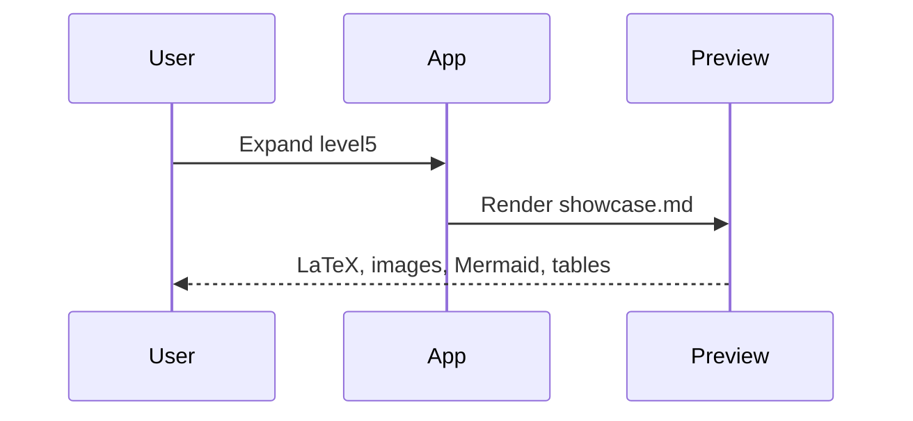

# Level 5 showcase

Folder five of five. This document exercises every preview feature that must work before
`1.0`.

## Code highlighting

```rust
use std::path::Path;

fn main() {
    let workspace = Path::new("examples/v1-workspace");
    let levels: Vec<_> = (1..=5).map(|depth| format!("level{depth}")).collect();
    println!("{} -> {levels:?}", workspace.display());
}
```

```json
{
  "nestedLevels": 5,
  "features": ["latex", "tables", "images", "svg", "mermaid"]
}
```

```bash
for level in $(seq 1 5); do
  printf 'level%s\n' "$level"
done
```

## Tables

| Feature | Expected result | Status |
|:--------|:----------------|-------:|
| Tables | Weighted columns fill the reading width | ready |
| LaTeX | Inline and display formulas render as images | ready |
| PNG | Local bitmap renders below | ready |
| SVG | Local vector renders below | ready |
| Mermaid | Flowchart and sequence diagrams render | ready |

## Lists and tasks

- [x] Five nested folders load lazily
- [x] Expanded folders survive watcher refreshes
- [x] Long checklist items with `inline code` stay on one logical line and wrap naturally
- [ ] Manual review before `1.0`

1. First ordered item
2. Second ordered item
   - nested bullet
   - another nested bullet with `code`

## LaTeX

Inline math: $E = mc^2$ and $\int_0^1 x^2\,dx = \frac{1}{3}$.

Display math:

$$
\sum_{n=1}^{\infty} \frac{1}{n^2} = \frac{\pi^2}{6}
$$

## Images

A generated PNG:


A local SVG:


## Mermaid




## Alerts, quotes, and footnotes

> [!NOTE]
> Alerts render with a title and a quiet surface.

> An ordinary quote keeps a left rule.

Footnote reference.[^v1]

[^v1]: Footnotes stay clickable and visible at the end of the document.

---

Long lines below must wrap without hiding content or forcing the whole page wider than the
reading column.
